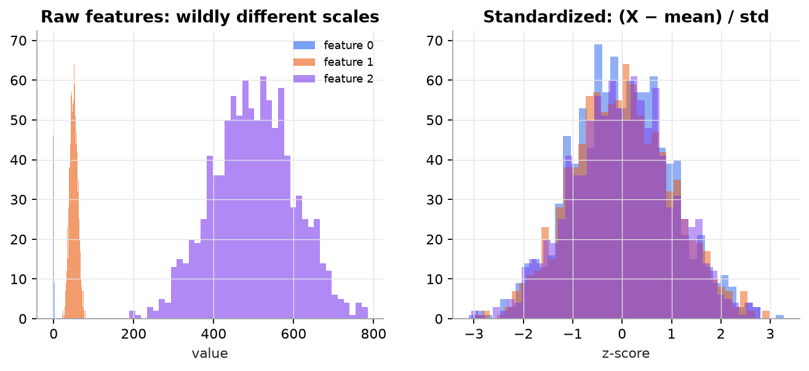

# The Python toolkit

> **Mental model.** NumPy is a calculator for whole arrays at once, pandas is a spreadsheet you can program, and matplotlib draws what you computed. Write operations on entire columns, never loops over rows.

**You will learn to**
- Create arrays, index and slice them, and reduce along an axis.
- Use broadcasting correctly (and recognize when it silently goes wrong).
- Load, inspect, clean, and group tabular data with pandas.
- Plot distributions and relationships with matplotlib.
- Make experiments reproducible with seeds and pinned environments.

**Why it matters.** Every lesson's code uses this stack. Vectorized code is shorter, easier to check against the math, and often 100× faster than Python loops.

## 1. Intuition

A NumPy array is a block of numbers of a single type with a **shape**. Operations apply element by element across the whole block, implemented in C. "Standardize every column" is one line: subtract the column means, divide by the column standard deviations.

**Broadcasting** lets arrays of different shapes combine: a `[1000, 3]` matrix minus a `[3]` vector subtracts the vector from every row. NumPy lines up shapes from the right and stretches dimensions of size 1.

pandas adds column names, mixed types, missing-value handling, and group-by on top of NumPy. Use it to explore and clean; convert to NumPy arrays (or pass DataFrames to scikit-learn) for modeling.

## 2. Visualization



*One broadcasting line, `(X - X.mean(axis=0)) / X.std(axis=0)`, standardizes all three columns.*

## 3. The math

### Broadcasting rules

Compare shapes from the rightmost dimension:

1. Dimensions are compatible if they are equal or one of them is 1.
2. Missing leading dimensions are treated as 1.
3. The result takes the larger size in each dimension.

| A | B | Result |
|---|---|---|
| `[1000, 3]` | `[3]` | `[1000, 3]` |
| `[1000, 3]` | `[1000, 1]` | `[1000, 3]` |
| `[1000]` | `[1000, 1]` | `[1000, 1000]` (usually a bug) |
| `[1000, 3]` | `[1000]` | error |

### Axis reductions

For $X$ of shape $[n, p]$: `X.mean(axis=0)` averages over rows, giving one value per column, shape $[p]$. `X.mean(axis=1)` gives one value per row, shape $[n]$.

### Worked example

$X = \begin{bmatrix}1 & 10\\3 & 30\end{bmatrix}$. Column means: $[2, 20]$. Population standard deviations: $[1, 10]$. Standardized: $\frac{X - [2, 20]}{[1, 10]} = \begin{bmatrix}-1 & -1\\1 & 1\end{bmatrix}$. Each column now has mean 0 and standard deviation 1.

## 4. Implementation

You will rebuild the two ideas that make NumPy fast and occasionally surprising: an array is a flat buffer plus a shape and strides, and broadcasting follows a three-rule shape check. Then the everyday NumPy, pandas, and matplotlib code you will write in every later lesson.

### Build it from scratch

Every n-dimensional array is stored as one flat run of numbers. Strides say how many elements to skip to move one step along each axis. In row-major (C) order the last axis is contiguous, so its stride is 1, and each earlier stride is the product of the sizes after it.

```python
def strides_for(shape):
    """Row-major (C order): the last axis moves fastest, so its stride is 1 element."""
    strides = [1] * len(shape)
    for i in range(len(shape) - 2, -1, -1):
        strides[i] = strides[i + 1] * shape[i + 1]
    return strides

def flat_index(index, strides):
    return sum(i * s for i, s in zip(index, strides))
```

**Predict:** for shape (2, 3, 4), what are the strides, and at which flat position does element [1, 2, 3] live?

This is why `reshape` and `transpose` are usually free: they write new shape and stride numbers and leave the buffer alone (a *view*). A transposed array is no longer contiguous, which is why some operations (`.view()` in PyTorch, for one) then demand a copy.

Broadcasting is section 3's rule, written out. Walk the shapes from the right; each pair must match or contain a 1, and missing dimensions count as 1.

```python
def broadcast_shape(a, b):
    """Align shapes from the right; each pair of dims must be equal or one of them must be 1."""
    out = []
    for i in range(1, max(len(a), len(b)) + 1):
        da = a[-i] if i <= len(a) else 1
        db = b[-i] if i <= len(b) else 1
        if da != db and 1 not in (da, db):
            raise ValueError(f"cannot broadcast {a} with {b}: {da} vs {db}")
        out.append(max(da, db))
    return tuple(reversed(out))
```

**Predict:** what do `(8, 1, 6)` with `(7, 1)` and `(3, 2)` with `(3,)` give? Which line of the table in section 3 does `(1000,)` with `(1000, 1)` match, and why is it usually a bug?

<details>
<summary>Answers</summary>

Strides are [12, 4, 1], so [1, 2, 3] sits at 1·12 + 2·4 + 3·1 = 23. `(8, 1, 6)` with `(7, 1)`: right-align to (1, 7, 1), so the result is (8, 7, 6). `(3, 2)` with `(3,)` fails: the rightmost pair is 2 versus 3. `(1000,)` with `(1000, 1)` gives (1000, 1000): a million-entry matrix when you wanted 1,000 element-wise differences, typically from subtracting a column vector from a flat one.

</details>

### Use the library

Real work uses NumPy for arrays, pandas for labelled tables, and matplotlib for plots. Seed the generator so every run gives the same numbers.

```python
import numpy as np
import pandas as pd
import matplotlib.pyplot as plt

rng = np.random.default_rng(42)                     # seeded: same numbers every run

# NumPy: vectorized standardization
X = rng.normal(size=(1000, 3)) * [1, 10, 100] + [0, 50, 500]
Z = (X - X.mean(axis=0)) / X.std(axis=0)            # [1000,3] - [3] broadcasts per row

# pandas: load, inspect, clean, aggregate
df = pd.DataFrame({"city": rng.choice(["A", "B", "C"], 1000), "price": rng.normal(300, 50, 1000)})
df.loc[rng.choice(1000, 20, replace=False), "price"] = np.nan
print(df.describe())                                # summary statistics
print(df.isna().sum())                              # missing values per column
df["price"] = df["price"].fillna(df["price"].median())
print(df.groupby("city")["price"].agg(["mean", "count"]))

# matplotlib: always label axes
fig, ax = plt.subplots()
ax.hist(df["price"], bins=40)
ax.set(xlabel="price ($k)", ylabel="count", title="Price distribution")
fig.savefig("price.png", dpi=150)
```

What the library adds: compiled loops over the flat buffer (the speed), `np.broadcast_shapes` (the scratch function above), and `arr.strides`, `np.shares_memory`, and `arr.flags` to inspect views. PyTorch tensors use the same shape, stride, and broadcasting model, so this transfers directly.

### Run it

From `guide/`:

```bash
uv run code/00-foundations/tensors_scratch.py
```

```text
shape (2, 3, 4) -> strides [12, 4, 1] (elements)
element [1, 2, 3] lives at flat position 23 -> 23
NumPy strides in bytes (96, 32, 8) = [12, 4, 1] × 8 bytes
transpose is a view: shape (4, 2, 3), strides (8, 96, 32), shares memory: True
contiguous after transpose? False
broadcast (1000, 3) with (3,) -> (1000, 3)
broadcast (4, 1) with (1, 5) -> (4, 5)
broadcast (8, 1, 6) with (7, 1) -> (8, 7, 6)
cannot broadcast (3, 2) with (3,): 2 vs 3
python loop 0.118s, vectorized 0.0012s, same result: True
all checks match NumPy
```

The timing line varies by machine; on a laptop the vectorized version is typically around 100× faster. Full script: [`code/00-foundations/tensors_scratch.py`](../../code/00-foundations/tensors_scratch.py). The figure comes from [`code/00-foundations/foundations.py`](../../code/00-foundations/foundations.py). The repository pins its dependencies in [`pyproject.toml`](../../pyproject.toml); `uv run` creates the same environment on any machine.

## 5. Engineering

**Reproducibility.** Fix random seeds (`np.random.default_rng(seed)`, `random_state=` in scikit-learn), pin package versions, and record the data version. An experiment you can't rerun is an anecdote.

**Performance.** Vectorize; avoid `df.apply` with Python functions on large frames; use appropriate dtypes (`float32`, `category`). Out-of-memory data needs chunking or tools like Polars, DuckDB, or Spark.

**Exploratory data analysis checklist.** Shape and dtypes; missing values per column; duplicates; distributions and outliers; target balance; time ranges; obviously leaky columns (IDs, timestamps after the event, "status" fields).

> [!WARNING]
> **Failure modes.** Accidental `[n] - [n, 1]` broadcasting; chained pandas indexing (`df[df.a > 0]["b"] = 1`) that silently modifies a copy; integer division and dtype overflow; filling missing values using statistics from the whole dataset (leakage).

### Common mistakes

- Looping over rows instead of using column operations.
- Forgetting `axis=` and reducing the whole array to one number.
- Unseeded randomness, so results change every run.

## 6. Knowledge check

<!-- quiz:python-toolkit -->
**[Take the Python toolkit quiz](../../quizzes/python-toolkit.md)**
<!-- /quiz -->

**Practice exercise.** Without running it, give the shape of `A + B` for `A.shape == (5, 1, 4)` and `B.shape == (3, 1)`.

<details>
<summary>Solution</summary>

Align from the right: (5, 1, 4) and (_, 3, 1). Compare: 4 vs 1 gives 4; 1 vs 3 gives 3; 5 vs missing gives 5. Result `(5, 3, 4)`.
</details>

**Implementation challenge.** Load any CSV with pandas, write an EDA function that prints missing values, duplicate count, numeric summaries, and the five most common values of each categorical column, and plot a histogram of every numeric column.

## Summary

- NumPy operates on whole arrays; broadcasting aligns shapes from the right.
- Reduce with an explicit `axis`; check shapes after every step.
- pandas handles loading, cleaning, missing values, and group-bys; plot with labeled axes.
- Seed randomness and pin versions so experiments are reproducible.

**Next:** [Information theory](05-information-theory.md)

**Related:** [The ML workflow](../02-ml-workflow/01-ml-workflow.md)

<!-- deeper: generated from guide/upstream/map.json by web/scripts/gen-upstream.mjs; edit the map, then run npm run gen:upstream -->
**Go deeper, code-first** ([AI Engineering from Scratch](https://aiengineeringfromscratch.com)): [Debugging and Profiling](https://aiengineeringfromscratch.com/lesson?path=phases/00-setup-and-tooling/12-debugging-and-profiling) · [Python for AI Engineering](https://aiengineeringfromscratch.com/lesson?path=phases/00-setup-and-tooling/13-python-for-ai-engineering)

*Parts of this lesson are adapted from [AI Engineering from Scratch](https://github.com/rohitg00/ai-engineering-from-scratch) by Rohit Ghumare (MIT license, [notice](../../upstream/LICENSE-ai-engineering-from-scratch.txt)): [Tensor Operations](https://aiengineeringfromscratch.com/lesson?path=phases/01-math-foundations/12-tensor-operations).*
<!-- /deeper -->

## Interview angle

<details>
<summary><strong>What happens when you subtract a [1000] array from a [1000, 1] array in NumPy, and how do you prevent it?</strong></summary>

Broadcasting aligns shapes from the right: `[1000]` is treated as `[1, 1000]`, each size-1 dimension stretches, and the result is `[1000, 1000]`, a million values where you expected a thousand. Nothing errors. A loss averaged over that matrix is still a finite number, just the wrong one, and memory jumps from 8 KB to 8 MB (or out of memory for larger $n$). Typical sources: a model output of shape `[n, 1]` compared with labels of shape `[n]`, or `X.mean(axis=1)` without `keepdims=True` subtracted from `X`. Prevention: keep vectors consistently 1-D or consistently `[n, 1]`, use `keepdims=True` when you want to broadcast a reduction back, and put `assert a.shape == b.shape` before element-wise arithmetic in loss and metric code. A unit test on a tiny input with a known answer catches it immediately.

</details>

<details>
<summary><strong>A colleague runs `df["x"].fillna(df["x"].median())` on the full dataset before splitting into train and test. What's wrong, and how should it be structured?</strong></summary>

The median is computed over all rows, including the test set, so test information leaks into the training features. For a median the leak is usually small, but the same pattern with scaling, target encoding, or feature selection can inflate scores substantially, and it means preprocessing isn't part of the model. Fix: split first, fit every statistic on the training split only, and apply it unchanged to validation, test, and production. In scikit-learn, put `SimpleImputer(strategy="median")` in a `Pipeline` with the model: `cross_val_score` then refits the imputer inside each fold automatically, and the fitted pipeline carries the training median into serving, which also prevents training-serving skew. Bonus: add a "was missing" indicator column (`add_indicator=True`), because missingness itself is often predictive.

</details>

<details>
<summary><strong>You rerun the same training script and get a different validation score every time. How do you make it reproducible, and what can still vary?</strong></summary>

Seed every source of randomness: create a NumPy generator with `np.random.default_rng(seed)` and pass it explicitly, seed Python's `random`, set `random_state=` on every scikit-learn splitter and estimator, and in PyTorch call `torch.manual_seed` and enable deterministic algorithms, with seeded DataLoader workers. Pin package versions in a lock file and record the data and code versions next to each result. What can still vary: GPU kernels that use atomic adds sum in nondeterministic order; different hardware, BLAS builds, or thread counts change floating-point summation order; and data loaded without a stable sort order reorders silently. Full bitwise determinism may cost speed. The deeper point: run several seeds anyway and report the mean and spread. If two configurations differ by less than the seed-to-seed standard deviation, you haven't shown one is better.

</details>
