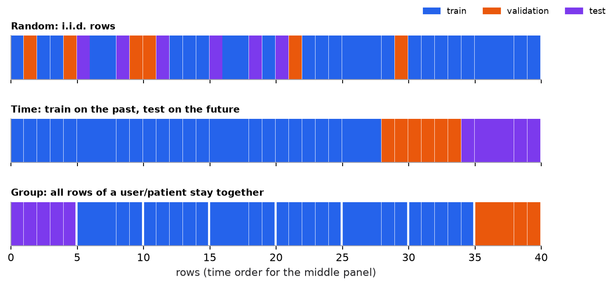

# Workflow, splits, and leakage

> **Mental model.** The test set is a dress rehearsal for production. Every decision about splitting, preprocessing, and features should ask: "Would this information exist at the moment we make a real prediction?"

**You will learn to**
- Walk through the nine-step ML workflow and name each step's deliverable.
- Choose random, stratified, time, or group splits for a problem.
- Detect three kinds of data leakage and measure their effect.
- Build a baseline and a leak-free preprocessing pipeline.
- Plan error analysis, deployment, and monitoring before training.

**Why it matters.** Most models that "worked in the notebook" and failed in production failed here: a random split for a forecasting problem, a feature that encodes the answer, preprocessing fit on all the data, or no monitoring after launch. Leakage produces numbers that look great and mean nothing.

## 1. Intuition

**Splits.** You train on one portion of the data, tune choices on a second (**validation**), and report final performance once on a third (**test**). The test set only estimates production performance if it differs from training the way production will:

- **Random split:** fine when examples are independent and identically distributed (i.i.d.).
- **Stratified split:** random, but preserving class proportions; important when one class is rare.
- **Time split:** train on the past, test on the future. Required for forecasting or any system where tomorrow's data informs nothing about yesterday.
- **Group split:** all rows of the same user, patient, or device go into the same split. Otherwise the model can recognize the *entity* rather than learn the *pattern*.

**Leakage** happens when training uses information that won't be available at prediction time:

- **Target leakage:** a feature recorded after the outcome ("refund issued" when predicting fraud).
- **Train-test contamination:** preprocessing (scaling, imputation, feature selection) fit on all data, or duplicates across splits.
- **Group/temporal leakage:** the same entity or future information appears on both sides of the split.

**Baselines.** Before any model, measure what a trivial rule achieves: predict the mean, the majority class, last week's value. A model that can't beat it isn't learning anything useful.

## 2. Visualization



Two measurements from the script (synthetic data):

| Setup | Score | What it means |
|---|---|---|
| Logistic regression, clean features | test accuracy 0.718 | honest estimate |
| Same, plus a feature recorded after the outcome | test accuracy 0.962 | impossible in production |
| 1-NN on repeated patient measurements, random 5-fold CV | 0.899 | memorizes patients |
| Same model, group 5-fold CV (patients never shared) | 0.498 | the truth: labels were pure noise |

The last two rows use labels that are *random*, unrelated to the features. A random split still reports 90% accuracy, because each patient's ten nearly identical rows land in both train and validation.

## 3. The math

### Symbols

| Symbol | Meaning |
|---|---|
| $\mathcal{D}_{\text{train}}, \mathcal{D}_{\text{val}}, \mathcal{D}_{\text{test}}$ | the three splits |
| $\hat{R}(f)$ | estimated risk (average loss or metric) of model $f$ on a split |
| $T$ | the time a prediction is made |
| $K$ | number of cross-validation folds |

### What a test score estimates

```math
\hat{R}_{\text{test}}(f) = \frac{1}{|\mathcal{D}_{\text{test}}|}\sum_{(x,y)\in \mathcal{D}_{\text{test}}} \ell\big(f(x), y\big) \;\approx\; \mathbb{E}_{(x,y)\sim \text{production}}\big[\ell(f(x), y)\big]
```

The approximation holds only if test examples are drawn like production examples and played no role in building $f$. Every leak breaks the second condition; a mismatched split breaks the first.

### K-fold cross-validation

Split the training data into $K$ folds; train on $K-1$, validate on the held-out fold, rotate, and average. It uses data efficiently for model selection, but the folds must respect the same rules as the final split (time-ordered folds for time series, group folds for grouped data).

### Worked example: is this feature legal?

Predicting at 9:00 on day $T$ whether a delivery will be late:

| Feature | Available at 9:00 on day $T$? | Verdict |
|---|---|---|
| distance to customer | yes | keep |
| driver's average lateness over the previous 30 days | yes, if computed from days before $T$ | keep, carefully |
| driver's average lateness over *all* data | no, includes the future | leak |
| actual delivery duration | no, it *is* the outcome | leak |
| weather forecast issued at 8:00 | yes | keep |
| observed weather at delivery time | no, unless the prediction is made later | leak |

## 4. Implementation

You will build a preprocessing pipeline from scratch (imputer, scaler, feature selector, model), a k-fold cross-validator, and then use them to manufacture 90% accuracy out of pure noise by fitting one step in the wrong place. Seeing the fake score is the fastest way to stop trusting unexplained ones.

### Build it from scratch

Every preprocessing step has two phases. `fit` learns statistics (medians, means, standard deviations) and `transform` applies them. The rule that prevents leakage is that `fit` only ever sees training rows; validation and test rows are transformed with the training statistics.

```python
class MedianImputer:
    def fit(self, X, y=None):
        self.medians_ = np.nanmedian(X, axis=0)           # learned from TRAINING rows only
        return self

    def transform(self, X):
        return np.where(np.isnan(X), self.medians_, X)

class Standardizer:
    def fit(self, X, y=None):
        self.mean_, self.std_ = X.mean(axis=0), X.std(axis=0) + 1e-12
        return self

    def transform(self, X):
        return (X - self.mean_) / self.std_
```

**Predict:** a test row has a feature value 3 standard deviations above the training mean. After `transform`, is it exactly 3.0, or recomputed from the test set's own mean?

Some steps look at the labels. A feature selector that keeps the columns most correlated with `y` is supervised, so it can leak the labels it was fit on.

```python
class TopKByCorrelation:
    """Keep the k features most correlated with y. It looks at y, so it can leak."""
    def __init__(self, k):
        self.k = k

    def fit(self, X, y):
        Xc, yc = X - X.mean(0), y - y.mean()
        corr = np.abs(Xc.T @ yc) / (np.linalg.norm(Xc, axis=0) * np.linalg.norm(yc) + 1e-12)
        self.keep_ = np.argsort(-corr)[: self.k]
        return self

    def transform(self, X):
        return X[:, self.keep_]
```

A pipeline chains the steps so they are fit together, on the same rows, every time. Passing the whole pipeline into cross-validation means each fold refits every step on its own training part.

```python
class Pipeline:
    def __init__(self, *steps):
        self.transforms, self.model = steps[:-1], steps[-1]

    def fit(self, X, y):
        for t in self.transforms:
            X = t.fit(X, y).transform(X)                   # fit, then pass the transformed data on
        self.model.fit(X, y)
        return self

    def predict(self, X):
        for t in self.transforms:
            X = t.transform(X)                             # transform only: reuse training statistics
        return self.model.predict(X)
```

K-fold cross-validation from section 3: shuffle once, cut into `k` folds, train a fresh model on `k − 1` of them, score the held-out one, average.

```python
def kfold_accuracy(make_model, X, y, k=5, seed=0):
    idx = np.random.default_rng(seed).permutation(len(y))
    folds = np.array_split(idx, k)
    scores = []
    for i in range(k):
        te = folds[i]
        tr = np.concatenate([folds[j] for j in range(k) if j != i])
        model = make_model().fit(X[tr], y[tr])
        scores.append(np.mean(model.predict(X[te]) == y[te]))
    return float(np.mean(scores))
```

Now the trap. 100 rows, 5,000 random features, coin-flip labels. Select the top 20 features on all 100 rows, *then* cross-validate.

```python
    Xn = rng.normal(size=(100, 5000))
    yn = rng.integers(0, 2, 100)
    keep = TopKByCorrelation(20).fit(Xn, yn).keep_         # WRONG: selection saw every label
    leaky = kfold_accuracy(LogisticRegression, Xn[:, keep], yn)
    honest = kfold_accuracy(lambda: Pipeline(TopKByCorrelation(20), LogisticRegression()), Xn, yn)
```

**Predict:** the labels are random, so the true accuracy of any model is 50%. What do `leaky` and `honest` come out to?

<details>
<summary>Answers</summary>

The test row stays at exactly 3.0: `transform` uses the training mean and standard deviation. Recomputing from the test set would erase real distribution shift and leak test statistics. On noise, `leaky` is 0.900 and `honest` is 0.560. Among 5,000 random columns, some correlate with these 100 particular labels by chance; selecting them on all rows lets every validation fold "see" its own labels through the choice of features. Inside the pipeline the selection is redone per fold and the score falls back toward chance (0.56 is within the noise of 50% on 20-row folds).

</details>

### Use the library

The production version is the same shape: `ColumnTransformer` routes numeric and categorical columns to their own steps, `make_pipeline` chains them, and the cross-validation splitters encode the split rules from section 3.

```python
from sklearn.compose import ColumnTransformer
from sklearn.impute import SimpleImputer
from sklearn.linear_model import LogisticRegression
from sklearn.model_selection import GroupKFold, TimeSeriesSplit, cross_val_score, train_test_split
from sklearn.pipeline import make_pipeline
from sklearn.preprocessing import OneHotEncoder, StandardScaler
from sklearn.dummy import DummyClassifier

# Stratified hold-out split (i.i.d. data)
X_train, X_test, y_train, y_test = train_test_split(X, y, test_size=0.2, stratify=y, random_state=42)

# Every preprocessing step lives INSIDE the pipeline, so it is fit on training folds only
pre = ColumnTransformer([
    ("num", make_pipeline(SimpleImputer(strategy="median"), StandardScaler()), numeric_cols),
    ("cat", OneHotEncoder(handle_unknown="ignore"), categorical_cols),
])
model = make_pipeline(pre, LogisticRegression(max_iter=1000))
baseline = cross_val_score(DummyClassifier(strategy="most_frequent"), X_train, y_train, cv=5).mean()
score = cross_val_score(model, X_train, y_train, cv=5).mean()

# Grouped and temporal data: use the matching splitters
cross_val_score(model, X, y, cv=GroupKFold(5), groups=user_ids)
cross_val_score(model, X_time_sorted, y_time_sorted, cv=TimeSeriesSplit(5))
```

What scikit-learn adds: `handle_unknown="ignore"` for categories first seen in production, stratified folds by default for classifiers, and one object you can pickle so serving runs exactly the transforms training ran (the cure for training-serving skew).

### Run it

From `guide/`:

```bash
uv run code/02-ml-workflow/pipeline_scratch.py
```

```text
missing values: 193 of 2000
scratch pipeline 5-fold accuracy: 0.748
noise labels: selection outside CV 0.900, selection inside CV 0.560
sklearn Pipeline, selection inside CV: 0.590
sklearn Pipeline on the real-signal data: 0.750
checks pass: leakage inflates noise to look like signal
```

All data is synthetic. Full script: [`code/02-ml-workflow/pipeline_scratch.py`](../../code/02-ml-workflow/pipeline_scratch.py). The target-leak and group-leak demonstrations and the figure are in [`code/02-ml-workflow/workflow.py`](../../code/02-ml-workflow/workflow.py).

## 5. Engineering

**Before training.** Write the problem statement: decision, prediction unit, target definition, prediction time, metric, and baseline. Version the dataset. Do EDA: missing values, duplicates (especially near-duplicates across splits), outliers, label balance, time coverage.

**During training.** Use pipelines so preprocessing is part of the model. Track experiments (code version, data version, configuration, seed, metrics). Look at the test set once, at the end.

**After training.** Error analysis: slice performance by segment, time, and input type; read the worst errors. Then deployment (batch scoring versus an online API), and monitoring of input distributions, prediction distributions, and delayed ground-truth performance.

**Reproducibility.** A result you can't regenerate from data version, code version, config, and seed should not ship.

> [!WARNING]
> **Leakage smells.** A score far better than published work or a strong baseline; one feature with overwhelming importance; near-perfect validation scores on a hard problem; a feature whose name contains "status," "final," "outcome," or a timestamp after the event.

### Common mistakes

- Random splits on time series or grouped data.
- Scaling, imputing, or selecting features before splitting.
- Re-using the test set to make decisions until it is effectively a validation set.
- Skipping the baseline, so nobody knows whether 0.82 is good.
- No plan for monitoring, so drift is discovered by customers.

## 6. Knowledge check

<!-- quiz:ml-workflow -->
**[Take the workflow and leakage quiz](../../quizzes/ml-workflow.md)**
<!-- /quiz -->

**Practice exercise.** You predict next-month churn for each customer using data up to the end of this month. Your dataset has 24 monthly snapshots per customer. Describe a split that is both time-correct and group-correct.

<details>
<summary>Solution</summary>

Pick a cutoff month: train on snapshots before it, validate on the month after, test on the month after that (time split). To also prevent per-customer memorization, either accept that the same customers appear across time (realistic, since production scores existing customers) or, if the goal is generalizing to *new* customers, additionally hold out a set of customer IDs entirely. Never let a training snapshot use features computed from months after its own prediction date.
</details>

**Implementation challenge.** Take any classification dataset, deliberately add a leaky feature (the label plus noise), and show the inflated cross-validation score. Then write a check that flags any single feature whose solo cross-validated score is suspiciously close to the full model's.

## Summary

- The workflow is frame, collect, explore, split, baseline, train, evaluate, deploy, monitor.
- Split the way production differs: random for i.i.d., time for forecasting, group for entities.
- Leakage (target, contamination, group, or temporal) inflates scores; ask whether each feature exists at prediction time.
- Keep preprocessing in pipelines; beat a baseline; look at the test set once.

**Next:** [Overfitting and the bias-variance trade-off](02-overfitting-and-bias-variance.md)

**Related:** [Classification metrics](../04-classification/02-classification-metrics.md) · [Reliability, cost, and observability](../20-production-ai/02-reliability-cost-and-observability.md)

<!-- deeper: generated from guide/upstream/map.json by web/scripts/gen-upstream.mjs; edit the map, then run npm run gen:upstream -->
*Parts of this lesson are adapted from [AI Engineering from Scratch](https://github.com/rohitg00/ai-engineering-from-scratch) by Rohit Ghumare (MIT license, [notice](../../upstream/LICENSE-ai-engineering-from-scratch.txt)): [ML Pipelines](https://aiengineeringfromscratch.com/lesson?path=phases/02-ml-fundamentals/13-ml-pipelines).*
<!-- /deeper -->

## Interview angle

<details>
<summary><strong>When does a random train/test split give a misleading score? Give concrete examples and the right split for each.</strong></summary>

Whenever examples aren't independent or production data differs from training in time. Forecasting: a random split lets the model train on Wednesday and test on Tuesday, using the future; use a time split with training before a cutoff and testing after it, plus a gap if labels take time to mature. Grouped data: many scans per patient or many sessions per user; a random split puts the same patient on both sides, and the model learns to recognize the patient rather than the disease. Use a group split such as `GroupKFold` by patient or user. Rare classes: a random split can leave the test set with almost no positives, so stratify. Near-duplicates (reposted text, the same product photo) need deduplication before splitting. Cross-validation folds must follow the same rules as the final split.

</details>

<details>
<summary><strong>Your first churn model scores 0.99 AUC. What do you do?</strong></summary>

Assume leakage until proven otherwise; 0.99 on a hard behavioral problem is a smell, not a result. Check feature importance first: a single dominant feature, especially one named like "status," "cancellation_date," or "account_closed," often encodes the outcome. For each top feature, ask whether it exists at prediction time; aggregates over the full history include the post-churn period. Check the split: are the same customers in train and test, and is it time-based? Check preprocessing: were scaling, imputation, target encoding, or feature selection fit on all data? Check for duplicates across splits. Then rerun with suspicious features removed and a strict time split; realistic churn AUCs are often 0.7 to 0.85. Compare against a simple baseline such as "days since last login" to calibrate expectations.

</details>

<details>
<summary><strong>K-fold cross-validation or a single holdout set: when do you use each?</strong></summary>

Cross-validation trains $K$ models, each validated on a different fold, and averages the scores. Every example is used for both training and validation, so the estimate has lower variance. That matters on small datasets (a few thousand rows or fewer), where a single 20% holdout gives a noisy number and a lucky split can decide your model choice. The cost is $K$ times the training compute. A single holdout is fine when data is large (the estimate is already precise), when training is expensive (deep learning, large boosted models), or when time order matters, in which case you use forward-chaining time folds rather than shuffled ones anyway. Either way, CV is for model selection: keep a separate untouched test set for the final estimate. Reporting the same CV score you tuned on is optimistic; nested CV corrects that.

</details>

<details>
<summary><strong>You've deployed a model whose labels arrive weeks late. What do you monitor, and what triggers action?</strong></summary>

Monitor in layers, because ground truth is slow. Available immediately: data quality (null rates, schema changes, out-of-range values); input feature distributions compared with training, using population stability index or KS statistics per feature; and the prediction distribution, such as the mean score and the fraction above the decision threshold. A sudden jump in alert rate is often the first sign of a broken upstream pipeline. Operational metrics: latency, error rate, throughput. When labels mature (chargebacks weeks later, churn after a month), compute the real metric on each matured cohort, compare it with the offline estimate, and slice by region, device, or customer type. Log features at serving time so you can rebuild training data without skew. Trigger investigation or retraining on sustained drift or a confirmed metric drop, not on every single alert.

</details>
