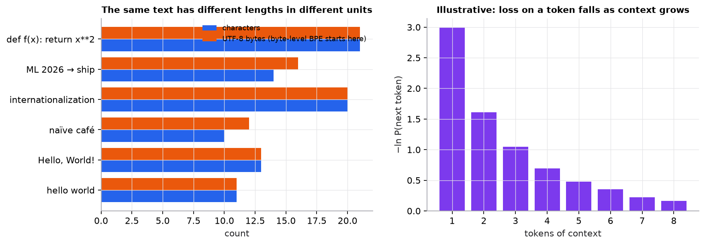

# Tokenization and pretraining

> **Mental model.** An LLM never sees text, only token IDs. Pretraining shows it trillions of tokens and asks one question at every position: what token comes next? Getting good at that single game requires learning grammar, facts, and patterns of reasoning, because they all help predict the next token.

**You will learn to**
- Explain why LLMs use subword tokens and run byte-pair-encoding merges by hand.
- Follow token IDs to embeddings to logits, and explain the context window.
- Compute next-token cross-entropy and perplexity for a short sequence.
- Describe pretraining data, checkpoints, and what pretraining does and does not produce.

**Why it matters.** Token counts, not characters, drive context limits, latency, and API cost. Cross-entropy and perplexity are how language models are trained and compared. And knowing that the objective is "predict likely text" explains both what LLMs are good at and why they hallucinate.

## 1. Intuition

**Tokens.** Word-level vocabularies can't handle new words, typos, or code; character-level sequences get very long. Subword tokenization is the compromise: common words become one token, rare words split into pieces ("unbelievable" might be "un", "believ", "able"). Byte-level BPE starts from raw bytes, so any string, in any language, can be encoded.

**The pipeline.** Text → tokens → integer IDs → embedding vectors → transformer blocks → a vector per position → logits over the vocabulary → softmax probabilities for the next token.

**The context window** is the maximum number of tokens the model can attend to at once (prompt plus generated output). Anything outside it does not exist for the model.

**Pretraining** is self-supervised: every position in every document is a training example whose label is the next token. The loss is cross-entropy, the negative log of the probability assigned to the true next token. The result is a **base model** that continues text fluently; it is not yet an assistant that follows instructions (that comes from [adaptation](03-adapting-llms.md)).

## 2. Visualization

<!-- lab:tokenizer -->


*Right panel is illustrative (not from a real model): more context usually makes the next token more predictable, which is why the same word costs less loss late in a document than at its start.*

*Interactive version: [open the lab](https://sreshtalluri.github.io/ml-ai-learn/labs/tokenizer/).*
<!-- /lab -->

**Try it** (predict first, then check):

1. Start at 0 merges and predict how many tokens your sentence has. Then step merges up and watch which pairs join first.
2. Type a word that never appears in the training corpus. Predict how it will be split, then check.
3. Press **Fill the context** and shrink the window. What has to give when text no longer fits?

## 3. The math

### Symbols

| Symbol | Meaning | Shape |
|---|---|---|
| $t_1, \dots, t_T$ | token IDs of a sequence | integers |
| $V$ | vocabulary size | scalar |
| $E$ | token embedding table | $[V, d]$ |
| $z_t$ | logits for the token after position $t$ | $[V]$ |
| $P_\theta(t_{k} \mid t_{<k})$ | model probability of token $k$ given all earlier tokens | scalar |

### Autoregressive objective

```math
\max_\theta \sum_{k=1}^{T} \log P_\theta(t_k \mid t_{<k})
\quad\Longleftrightarrow\quad
\min_\theta\; \mathcal{L} = -\frac{1}{T}\sum_{k=1}^{T} \log P_\theta(t_k \mid t_{<k})
```

Thanks to the causal mask, one forward pass over a sequence computes the loss for all $T$ positions in parallel.

### Perplexity

```math
\text{PPL} = \exp(\mathcal{L})
```

Perplexity is the effective number of tokens the model is "choosing between." A model guessing uniformly over 50,000 tokens has loss $\ln 50000 = 10.82$ and perplexity 50,000.

### Byte-pair encoding

Start with characters (or bytes). Repeatedly count every adjacent pair across the corpus and merge the most frequent pair into a new token, until the vocabulary reaches the target size.

### Worked example 1: BPE merges

Toy corpus word counts: "low" ×5, "lower" ×2, "newest" ×6, "widest" ×3 (with an end-of-word marker `</w>`).

1. Most frequent pair: `e s` (6 in "newest" + 3 in "widest" = 9). Merge into `es`.
2. Next: `es t` (9). Merge into `est`.
3. Next: `est </w>` (9). Merge into `est</w>`.
4. Next: `l o` (5 + 2 = 7). Merge into `lo`.
5. Next: `lo w` (7). Merge into `low`.

After five merges, "newest" is `n e w est</w>` and "low" is `low </w>`. Frequent fragments become single tokens.

### Worked example 2: cross-entropy and perplexity

A model assigns these probabilities to the actual next tokens in a 4-token sequence: $0.6, 0.25, 0.9, 0.05$.

| Token | $P(\text{true})$ | Loss $-\ln P$ |
|---|---|---|
| 1 | 0.60 | 0.511 |
| 2 | 0.25 | 1.386 |
| 3 | 0.90 | 0.105 |
| 4 | 0.05 | 2.996 |

Mean loss $= (0.511 + 1.386 + 0.105 + 2.996)/4 = 1.250$. Perplexity $= e^{1.250} = 3.49$. One surprising token (probability 0.05) contributes more than half the loss.

## 4. Implementation

The full script is [`code/15-llms/bpe_pretrain_scratch.py`](../../code/15-llms/bpe_pretrain_scratch.py) (stdlib and NumPy only, runs in about a second on a laptop CPU). It builds the whole path from text to a trained model: a byte-level BPE tokenizer, a sliding-window dataset, and a pretraining loop with hand-written gradients.

### Build it from scratch

**Step 1: split into chunks, count pairs.** Real tokenizers first cut text into words and whitespace runs so a merge never glues the end of one word to the start of the next. Each distinct chunk is stored once with its count, so counting pairs costs one pass over the distinct chunks, not the whole text.

```python
def pretokenize(text):
    return re.findall(r"\S+|\s+", text)          # merges never cross a word/space boundary

def count_pairs(units):                           # units: {tuple of ids: count}
    pairs = Counter()
    for sym, c in units.items():
        for a, b in zip(sym, sym[1:]):
            pairs[(a, b)] += c
    return pairs
```

*Predict:* in the toy corpus, "newest" appears 6 times. How much does it add to the count of the pair `(e, s)`?

**Step 2: the training loop.** Start from the 256 byte values, so any string in any language is representable and there is no unknown token. Each round merges the most frequent pair into a new ID. Ties go to the smallest pair, so two runs on the same text learn the same merges.

```python
def train_bpe(text, vocab_size):
    vocab = {i: bytes([i]) for i in range(256)}   # ids 0..255 are raw bytes: nothing is ever unknown
    merges = {}                                   # (a, b) -> new id, in the order learned
    units = Counter(tuple(w.encode("utf-8")) for w in pretokenize(text))
    while len(vocab) < vocab_size:
        pairs = count_pairs(units)
        if not pairs:
            break
        best = min(pairs, key=lambda p: (-pairs[p], p))   # most frequent; ties -> smallest pair
        if pairs[best] < 2:
            break
        new_id = len(vocab)
        vocab[new_id] = vocab[best[0]] + vocab[best[1]]
        merges[best] = new_id
        units = Counter({apply_merge(s, best, new_id): c for s, c in units.items()})
    return vocab, merges
```

`apply_merge` (in the script) walks one chunk left to right and replaces each `(a, b)` with the new ID. On the toy corpus this learns `es`, `est`, `lo`, `low`, then `ew`. That differs from worked example 1 at the third merge: byte-level BPE has no `</w>` end-of-word marker, so `est </w>` is not a pair; the space after a word is its own chunk instead.

*Predict:* why stop when the best pair has count 1?

**Step 3: encode by replaying merges in learned order.** Encoding a new string does not count anything. It repeatedly finds the adjacent pair with the earliest merge rank and applies it, until no learned merge applies. Decoding is just concatenating each ID's bytes.

```python
def encode(text, merges):
    rank = {p: r for r, p in enumerate(merges)}   # earlier merge = higher priority
    ids = []
    for w in pretokenize(text):
        sym = tuple(w.encode("utf-8"))
        while len(sym) > 1:
            pair = min(zip(sym, sym[1:]), key=lambda p: rank.get(p, math.inf))
            if pair not in rank:
                break                             # no learned merge applies any more
            sym = apply_merge(sym, pair, merges[pair])
        ids.extend(sym)
    return ids
```

*Predict:* "café" contains é, which is two bytes in UTF-8. If the training text never had an é, how many tokens does "é" become?

**Step 4: turn one long ID stream into training examples.** Pretraining data is a single stream of token IDs. Cut it into windows of $T + 1$ IDs; the input is the first $T$, the target is the same window shifted left by one. Every position in a window is a training example, which is why one forward pass gives $T$ losses.

```python
def windows(ids, T, stride):
    ids = np.asarray(ids)
    starts = range(0, len(ids) - T, stride)       # each window needs T + 1 ids
    X = np.stack([ids[s:s + T] for s in starts])
    Y = np.stack([ids[s + 1:s + T + 1] for s in starts])
    return X, Y                                   # both [n_windows, T]
```

*Predict:* with stride smaller than $T$, windows overlap. What goes wrong if you split train and validation *after* making overlapping windows?

**Step 5: the smallest possible language model.** A real LLM puts transformer blocks between the embedding and the output projection. To keep the backward pass short, this model skips them: it looks up the current token's embedding and maps it straight to logits, so it can only use one token of context (a neural bigram model). The loss is the same cross-entropy as section 3.

```python
def forward(params, X, Y):
    h = params["E"][X]                            # [B, T, d]   token embeddings
    logits = h @ params["W"]                      # [B, T, V]   scores for the next token
    logits -= logits.max(-1, keepdims=True)
    p = np.exp(logits); p /= p.sum(-1, keepdims=True)
    loss = -np.log(np.take_along_axis(p, Y[..., None], -1)).mean()
    return loss, h, p
```

*Predict:* before any training the weights are small random numbers. What loss should step 0 print, roughly? (Hint: what is the loss of a uniform guess over $V$ tokens?)

**Step 6: backward pass and update.** The gradient of softmax plus cross-entropy with respect to the logits is $p - \text{onehot}(y)$, divided by the number of positions because the loss is a mean. The rest is the chain rule through two matrix products. `np.add.at` matters: if a token appears twice in a batch, its embedding row must receive both gradients.

```python
def train_step(params, X, Y, lr):
    loss, h, p = forward(params, X, Y)
    d_logits = p.copy()
    d_logits[np.arange(Y.shape[0])[:, None], np.arange(Y.shape[1]), Y] -= 1   # softmax + CE gradient: p - onehot
    d_logits /= Y.size                                                          # mean over all positions
    dW = h.reshape(-1, h.shape[-1]).T @ d_logits.reshape(-1, d_logits.shape[-1])
    dE = np.zeros_like(params["E"])
    np.add.at(dE, X, d_logits @ params["W"].T)    # scatter-add: a token used twice gets both grads
    params["W"] -= lr * dW
    params["E"] -= lr * dE
    return loss
```

*Predict:* if you wrote `dE[X] += ...` instead of `np.add.at`, which tokens would get too little gradient?

The main block samples random batches of 16 windows, takes 300 steps, and prints validation loss next to two baselines: a uniform guess and a unigram model (token frequencies only).

### Use the library

In practice you load a trained tokenizer and write the loop in PyTorch, where autograd replaces step 6:

```python
import tiktoken                                      # pip install tiktoken
enc = tiktoken.get_encoding("cl100k_base")
ids = enc.encode("Tokenization splits text into subword units; unbelievable!")
print(len(ids), [enc.decode([i]) for i in ids])
```

```python
import torch.nn.functional as F
# logits: [B, T, V] from the model; tokens: [B, T+1] one window per row
logits = model(tokens[:, :-1])                       # inputs: positions 0..T-1
targets = tokens[:, 1:]                              # targets: the same window shifted by one
loss = F.cross_entropy(logits.reshape(-1, logits.size(-1)), targets.reshape(-1))
loss.backward(); optimizer.step(); optimizer.zero_grad()
perplexity = loss.exp()
```

What the libraries add: tiktoken and Hugging Face `tokenizers` run the same merge replay in Rust with a smarter pre-tokenization regex (splitting digits, punctuation, and contractions), and handle special tokens like `<|endoftext|>`. A real training loop adds AdamW, a learning rate that warms up and then decays on a cosine curve, gradient clipping, mixed precision, and checkpoints. The objective does not change.

### Run it

```bash
uv run code/15-llms/bpe_pretrain_scratch.py
```

Key lines of output (synthetic training paragraph):

```text
first 5 merges: ['es', 'est', 'lo', 'low', 'ew']
tokens: ['the', ' ', 'token', 'i', 'z', 'er', ' ', 'pr', 'ed', 'i', 'c', 't', 's', ' ', 'r', 'ar', 'e', ' ', 'tokens', '.', ' ', 'n', 'a', '<c3>', '<af>', 'v', 'e', ' ', 'c', 'a', 'f', '<c3>', '<a9>', '!']
49 bytes -> 34 tokens; round trip ok: True
423 tokens -> X (52, 8), Y (52, 8)
baselines on validation: uniform ln V = 5.756, unigram = 3.771
step   0  train loss 5.764  val loss 5.737  val perplexity  310.2
step 200  train loss 2.012  val loss 3.747  val perplexity   42.4
step 300  train loss 1.613  val loss 3.942  val perplexity   51.5
greedy continuation of 'the': ' the the the the'
```

Read it as a pretraining run in miniature. Step 0 sits at $\ln V$, a uniform guess. Words seen in training ("token", "tokens") become single tokens, while "é", never seen, falls back to its two raw bytes. Training loss keeps falling, but validation loss bottoms out near step 200, barely below the unigram baseline, and then rises: with 423 tokens the model memorizes rather than generalizes, which is why real pretraining uses trillions of tokens and watches held-out loss. The greedy continuation loops because a bigram model only sees the last token; [decoding](02-decoding.md) covers why greedy decoding repeats even in large models.

## 5. Engineering

**Token economics.** Cost and latency scale with tokens. The same content can take very different token counts across languages and tokenizers (non-English text and code often take more). Measure with the actual tokenizer of the model you deploy.

**Context management.** Long prompts cost more and attention over long contexts is expensive; models can also attend poorly to material buried in the middle of very long contexts. Retrieve and include only what is relevant ([RAG](../16-rag/01-rag-pipeline.md)).

**BPE is one of three tokenizer algorithms.** WordPiece (BERT) also merges pairs, but picks the pair that most raises corpus likelihood, roughly count(ab) / (count(a) · count(b)), instead of the raw count. Unigram (T5, many SentencePiece models) works the other way: start with a large candidate vocabulary and prune the tokens whose removal hurts corpus likelihood least. SentencePiece is a library that trains BPE or Unigram on raw text and writes spaces as `▁`; tiktoken only encodes with a pre-built vocabulary. For an LLM you will almost always reuse the base model's tokenizer; you train one only when you pretrain.

**Pretraining data** quality (deduplication, filtering, mixing) matters as much as quantity. Training saves **checkpoints**: snapshots of the weights you can resume from or evaluate.

**What pretraining does not give you:** instruction following, refusal behavior, or calibrated truthfulness. The model learned to produce likely text, which is not the same as true text.

> [!IMPORTANT]
> An LLM produces a probability distribution over the next token. It is not a database of facts. High probability means "this is the kind of thing that tends to come next," not "this is correct."

> [!WARNING]
> **Failure modes.** Tokenization quirks (arithmetic on numbers split into odd chunks, trailing-space differences, words split differently with and without capitalization); prompts silently truncated at the context limit; comparing perplexities across models with different tokenizers (not comparable).

### Common mistakes

- Estimating cost from characters or words instead of tokens.
- Forgetting to shift targets by one position when computing the language-modeling loss.
- Treating a base model's fluent continuation as an answer to a question.

## 6. Knowledge check

<!-- quiz:tokenization-and-pretraining -->
**[Take the tokenization and pretraining quiz](../../quizzes/tokenization-and-pretraining.md)**
<!-- /quiz -->

**Practice exercise.** A model assigns probabilities 0.5, 0.5, 0.125 to three actual next tokens. Compute the mean loss and perplexity.

<details>
<summary>Solution</summary>

Losses: $\ln 2 = 0.693$, $0.693$, and $\ln 8 = 2.079$. Mean $= 3.466/3 = 1.155$. Perplexity $= e^{1.155} = 3.17$ (equivalently $(2 \times 2 \times 8)^{1/3} = 32^{1/3} = 3.17$).
</details>

**Implementation challenge.** The model in section 4 sees one token of context. Give it two: concatenate the embeddings of the previous two tokens (`h` becomes `[B, T, 2d]`, `W` becomes `[2d, V]`), update the backward pass, and compare validation loss with the bigram model on the same windows. Does more context help on 423 tokens of training text?

<details>
<summary>Solution sketch</summary>

Build `h = concat(E[X_prev], E[X])` where `X_prev` is `X` shifted right by one (pad position 0 with a fixed token). The logits gradient is unchanged (`p - onehot`). `dW = h_flat.T @ d_logits_flat`. Split `d_logits @ W.T` into its two halves of width `d` and scatter-add each half into `dE` at `X_prev` and `X`. Expect training loss to drop lower and validation loss to overfit even sooner: more context means more parameters per pattern and the same tiny data. That is the scaling story in one experiment: bigger models need more tokens.
</details>

## Summary

- Subword tokenization (BPE) balances vocabulary size and sequence length; byte-level BPE can encode any text.
- Tokens become IDs, then embeddings, then logits over the vocabulary; the context window caps how many tokens the model sees.
- Pretraining minimizes next-token cross-entropy over massive text; perplexity $= e^{\text{loss}}$.
- A pretrained base model predicts likely text, not guaranteed truth.

**Next:** [Decoding](02-decoding.md)

**Related:** [The transformer architecture](../14-transformers/02-transformer-architecture.md) · [Learning paradigms](../01-ml-vocabulary/02-learning-paradigms.md) · [Model card: large language model](../../models/large-language-model.md)

<!-- deeper: generated from guide/upstream/map.json by web/scripts/gen-upstream.mjs; edit the map, then run npm run gen:upstream -->
**Go deeper, code-first** ([AI Engineering from Scratch](https://aiengineeringfromscratch.com)): [Text Generation Before Transformers — N-gram Language Models](https://aiengineeringfromscratch.com/lesson?path=phases/05-nlp-foundations-to-advanced/16-text-generation-pre-transformer) · [Multilingual NLP](https://aiengineeringfromscratch.com/lesson?path=phases/05-nlp-foundations-to-advanced/18-multilingual-nlp) · [GPT — Causal Language Modeling](https://aiengineeringfromscratch.com/lesson?path=phases/07-transformers-deep-dive/07-gpt-causal-language-modeling) · [Tokenizers: BPE, WordPiece, SentencePiece](https://aiengineeringfromscratch.com/lesson?path=phases/10-llms-from-scratch/01-tokenizers) · [Building a Tokenizer from Scratch](https://aiengineeringfromscratch.com/lesson?path=phases/10-llms-from-scratch/02-building-a-tokenizer) · [Data Pipelines for Pre-Training](https://aiengineeringfromscratch.com/lesson?path=phases/10-llms-from-scratch/03-data-pipelines) · [Pre-Training a Mini GPT (124M Parameters)](https://aiengineeringfromscratch.com/lesson?path=phases/10-llms-from-scratch/04-pre-training-mini-gpt)

*Parts of this lesson are adapted from [AI Engineering from Scratch](https://github.com/rohitg00/ai-engineering-from-scratch) by Rohit Ghumare (MIT license, [notice](../../upstream/LICENSE-ai-engineering-from-scratch.txt)): [BPE Tokenizer From Scratch](https://aiengineeringfromscratch.com/lesson?path=phases/19-capstone-projects/30-bpe-tokenizer-from-scratch), [Tokenized Dataset with Sliding Window](https://aiengineeringfromscratch.com/lesson?path=phases/19-capstone-projects/31-tokenized-dataset-sliding-window), [Training Loop and Evaluation](https://aiengineeringfromscratch.com/lesson?path=phases/19-capstone-projects/36-training-loop-eval), [Subword Tokenization — BPE, WordPiece, Unigram, SentencePiece](https://aiengineeringfromscratch.com/lesson?path=phases/05-nlp-foundations-to-advanced/19-subword-tokenization).*
<!-- /deeper -->

## Interview angle

<details>
<summary><strong>How does byte-pair encoding work, and why do LLMs use subword tokens?</strong></summary>

BPE builds a vocabulary by repeatedly merging the most frequent adjacent pair. Start from characters, or raw bytes in byte-level BPE, count every adjacent pair across the corpus, merge the most common pair into a new token, and repeat until the vocabulary hits its target size. Encoding replays the merges in order. In the course corpus, `e s` (count 9) merges first, then `es t`, then `est </w>`, so "newest" becomes `n e w est</w>`. Subwords are the compromise between two bad options. Word-level vocabularies can't represent new words, typos, or code; character-level sequences are several times longer, which makes attention more expensive and the context fill faster. Subwords keep common words as single tokens and split rare ones into reusable pieces. Byte-level BPE guarantees any string in any language can be encoded, with no unknown token.

</details>

<details>
<summary><strong>Model A has validation loss 2.0 nats per token, model B has perplexity 6.5. Which is better?</strong></summary>

You can't tell unless they share a tokenizer. Model A's perplexity is $e^{2.0} = 7.39$, so on paper B looks better. But perplexity is per token, and tokens differ between tokenizers: a tokenizer with longer tokens has fewer, harder predictions per document and naturally gets higher per-token loss. The fair comparison normalizes by a tokenizer-independent unit, usually bytes or characters of the same text. Total loss in nats divided by total bytes, then divided by $\ln 2$, gives bits per byte. Example: if A averages 4 bytes per token, it costs $2.0/4 = 0.5$ nats per byte, $0.5/0.693 \approx 0.72$ bits per byte. If B's tokens average 3 bytes, $\ln 6.5 = 1.87$ nats per token becomes $0.62$ nats per byte, $0.90$ bits per byte, so A is actually better. Also make sure both are evaluated on the same held-out text.

</details>

<details>
<summary><strong>Your LLM can't count the letters in a word and makes arithmetic mistakes on long numbers. Why, and what do you do?</strong></summary>

It doesn't see letters or digits; it sees token IDs. "strawberry" may be two or three tokens, and the model has no direct access to the characters inside each one, so counting letters needs knowledge it must have memorized about each token's spelling. Numbers are often split into irregular chunks, such as "12345" becoming "123" and "45", so digit positions don't line up across numbers and column-wise carrying is hard to learn. Some tokenizers split numbers into single digits for exactly this reason. In production, don't ask the model to be a calculator: give it a tool (code execution or a calculator function) for arithmetic and string operations and have it call the tool. If you must handle it in-model, spelling the input character by character or digit by digit in the prompt helps. Check how your tokenizer splits such inputs before debugging the model.

</details>

<details>
<summary><strong>What is the trade-off in choosing a 32,000-token versus a 256,000-token vocabulary?</strong></summary>

A larger vocabulary makes sequences shorter but costs parameters and softmax compute, and spreads training signal across more tokens. Benefits of 256k: common words, code fragments, and non-English text become fewer tokens, so the same content fits in less context, attention is cheaper, generation needs fewer steps, and multilingual users aren't penalized with 2x to 3x more tokens for the same text. Costs: the embedding table is $V \times d$. At $d = 4096$, 32k needs $131$M parameters and 256k needs about $1.05$B, and an untied output head doubles that. The final softmax over $V$ logits runs at every position, which matters for smaller models. Rare tokens see few training examples, so their embeddings are undertrained, and glitchy tokens that almost never appeared in training can cause strange behavior. Large multilingual models trend toward bigger vocabularies; small models favor smaller ones.

</details>
