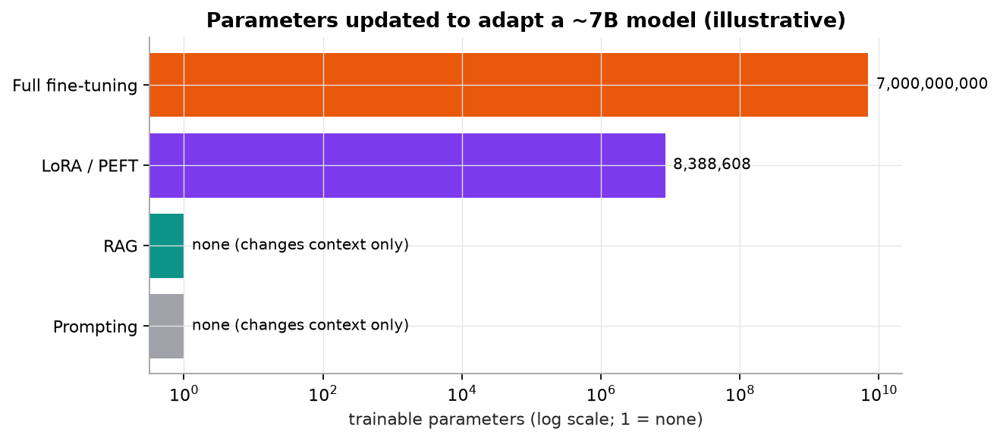

# Adapting LLMs

> **Mental model.** There are two places to change an LLM's behavior: its context (what you put in the prompt at runtime) and its weights (what it learned in training). Prompting and RAG change the context. Fine-tuning, LoRA, and preference optimization change the weights. Facts that change belong in the context; behavior, format, and style belong in the weights.

**You will learn to**
- Compare prompting, RAG, full fine-tuning, LoRA/PEFT, and preference optimization by what they change and what they cost.
- Explain instruction tuning and alignment at a high level.
- Compute LoRA's trainable-parameter savings.
- Explain why LLMs hallucinate and which mitigations actually help.
- Choose an adaptation strategy for a concrete product requirement.

**Why it matters.** "Should we fine-tune?" is one of the most common and most expensive questions in AI engineering. Answering it well saves months and avoids building systems that confidently state outdated or invented facts.

## 1. Intuition

A pretrained base model continues text. To make it useful:

- **Prompting:** describe the task, give examples (few-shot), and specify the output format. Fastest; no training. Limited by context length and by what the model already knows.
- **RAG:** retrieve relevant documents at query time and put them in the prompt. Adds fresh or private knowledge and enables citations without retraining.
- **Instruction tuning (supervised fine-tuning):** train on (instruction, good response) pairs so the model follows instructions. This is how base models become assistants.
- **Full fine-tuning:** update all weights on your task data. Most powerful, most expensive, risks forgetting general skills.
- **LoRA / PEFT (parameter-efficient fine-tuning):** freeze the base weights and train small add-on matrices. Most of the benefit of fine-tuning at a fraction of the memory and storage.
- **Preference optimization (RLHF, DPO):** train on pairs of responses ranked by humans (or models) so the model prefers helpful, harmless, honest answers. Shapes behavior and style.

**Hallucinations** are fluent but unsupported claims. They follow from the objective: the model produces likely text, and a plausible-sounding answer is likely even when false.

## 2. Visualization



*Illustrative sizes: LoRA with rank 8 on the four attention projections of 32 layers with width 4096 trains about 8.4 million parameters, about 0.1% of a 7B model.*

## 3. The math

### Symbols

| Symbol | Meaning | Shape |
|---|---|---|
| $W_0$ | a frozen pretrained weight matrix | $[d_{\text{out}}, d_{\text{in}}]$ |
| $A, B$ | LoRA low-rank factors | $[r, d_{\text{in}}]$, $[d_{\text{out}}, r]$ |
| $r$ | LoRA rank, much smaller than $d$ | scalar |
| $\alpha$ | LoRA scaling factor | scalar |
| $y_w, y_l$ | preferred and rejected responses | text |

### LoRA

```math
W = W_0 + \frac{\alpha}{r} B A, \qquad \text{trainable parameters} = r\,(d_{\text{in}} + d_{\text{out}}) \;\ll\; d_{\text{in}} d_{\text{out}}
```

$B$ starts at zero, so training begins exactly at the pretrained model. After training, $BA$ can be merged into $W_0$, adding no inference latency, or kept separate so many small adapters can share one base model.

### Supervised fine-tuning loss

The same next-token cross-entropy as pretraining, computed only on the response tokens of (instruction, response) pairs.

### Direct preference optimization (DPO), intuition

Given a prompt with a preferred response $y_w$ and a rejected one $y_l$, increase the model's log-probability of $y_w$ relative to $y_l$, measured against a frozen reference model so the policy doesn't drift too far. It reaches a similar goal to RLHF without training a separate reward model or running reinforcement learning.

### Worked example: LoRA savings

One attention projection is $4096 \times 4096$: $16{,}777{,}216$ parameters. LoRA with $r = 8$ trains $8 \times (4096 + 4096) = 65{,}536$, which is $0.39\%$ of that matrix. Applied to Q, K, V, and O in 32 layers: $65{,}536 \times 4 \times 32 = 8{,}388{,}608$ trainable parameters, about 0.12% of a 7-billion-parameter model. Storing that adapter in 16-bit precision takes about 17 MB instead of about 14 GB for a full copy.

### Worked example: choosing an approach

| Requirement | Best first approach | Why |
|---|---|---|
| Answer questions about internal docs that change weekly | RAG | facts live in context; update by re-indexing, with citations |
| Always output a specific JSON schema | prompting plus structured outputs; LoRA if still unreliable | format is behavior |
| Write in the company's support tone | few-shot prompting, then LoRA on examples | style is behavior |
| Classify tickets into 30 categories with 50,000 labeled examples | fine-tune a small model (or LoRA) | cheaper and faster than prompting a large model per ticket |
| Know this year's product prices | RAG or tool calls | fine-tuning is a poor way to inject frequently changing facts |

## 4. Implementation

Prompting and RAG need no training code; [RAG](../16-rag/01-rag-pipeline.md) has its own lesson. What hides the most mechanism is preference tuning, so the build below covers it: [`code/15-llms/preference_scratch.py`](../../code/15-llms/preference_scratch.py) (NumPy only) checks the LoRA arithmetic, trains a reward model on preference pairs, and trains a toy policy with DPO. The policy is a softmax over four whole responses instead of a token-by-token LLM, which keeps every gradient to one line while the loss stays exactly DPO's.

### Build it from scratch

**Step 1: LoRA's parameter count.** $A$ is $[r, d_{\text{in}}]$ and $B$ is $[d_{\text{out}}, r]$, so the adapter trains $r(d_{\text{in}} + d_{\text{out}})$ numbers instead of $d_{\text{in}} d_{\text{out}}$.

```python
def lora_params(d_in, d_out, r):
    return r * (d_in + d_out)                     # A: [r, d_in] plus B: [d_out, r]
```

*Predict:* doubling $r$ from 8 to 16 doubles the adapter. What does doubling $d$ from 4096 to 8192 do to the adapter, and to the full matrix?

**Step 2: preference data.** Raters see two responses and pick one. They are noisy, so this script simulates them with the Bradley-Terry model: the better response wins with probability $\sigma(s_i - s_j)$, where $s$ is a hidden quality score (synthetic: 2, 1, 0, −1).

```python
RESPONSES = ["cites the policy and answers", "answers, no citation", "vague hedge", "confident but wrong"]
TRUE_SCORE = np.array([2.0, 1.0, 0.0, -1.0])     # hidden quality, synthetic

def sample_pairs(n, rng):
    pairs = []
    for _ in range(n):
        i, j = rng.choice(4, size=2, replace=False)
        p_i = 1 / (1 + np.exp(-(TRUE_SCORE[i] - TRUE_SCORE[j])))   # Bradley-Terry: noisy raters
        pairs.append((i, j) if rng.random() < p_i else (j, i))     # (chosen, rejected)
    return np.array(pairs)
```

*Predict:* when "answers, no citation" (score 1) meets "vague hedge" (score 0), how often does the rater pick the worse one?

**Step 3: the reward model, the first stage of RLHF.** Learn a reward $r(y)$ so that $\sigma(r_w - r_l)$ matches the labels: logistic regression on the reward margin. Here each response gets one free scalar; a real reward model is an LLM with a scalar head, trained with this same loss.

```python
def train_reward_model(pairs, steps=2000, lr=0.5):
    r = np.zeros(4)                               # one scalar reward per response (a real RM is a network)
    w, l = pairs[:, 0], pairs[:, 1]
    for _ in range(steps):
        g = sigmoid(r[w] - r[l]) - 1              # d/dmargin of -log sigmoid(r_w - r_l)
        grad = np.zeros(4)
        np.add.at(grad, w, g); np.add.at(grad, l, -g)
        r -= lr * grad / len(pairs)
        r -= r.mean()                             # rewards are only defined up to a constant
    return r
```

*Predict:* add 10 to every reward. Does the loss change?

**Step 4: the DPO loss.** DPO skips the reward model. It scores each response by how much more likely the policy makes it than the frozen reference does (the log-ratio), and applies the same logistic loss to the gap, scaled by $\beta$.

```python
def dpo_loss(chosen_logratio, rejected_logratio, beta):
    """Each log-ratio is log pi_theta(y|x) - log pi_ref(y|x), summed over the response's tokens."""
    return -np.log(sigmoid(beta * (chosen_logratio - rejected_logratio)))
```

At step 0 the policy equals the reference, both log-ratios are 0, and the loss is $-\ln 0.5 = 0.693$ for every pair. With log-ratios $+2.0$ and $-1.0$ at $\beta = 0.1$, it is $0.554$, the numbers worked in [fine-tuning in practice](04-fine-tuning-in-practice.md).

*Predict:* if the chosen and rejected log-ratios both fall by 5, what happens to the loss?

**Step 5: DPO training.** The policy is logits $\theta$ over the four responses. The gradient of $\log \pi(y)$ with respect to $\theta$ is $\text{onehot}(y) - \pi$; in a chosen-minus-rejected difference the $\pi$ terms cancel, which is why the update is so short.

```python
def train_dpo(pairs, beta, steps=3000, lr=1.0):
    theta = np.zeros(4)                           # policy logits; start equal to the reference
    ref = log_softmax(theta)                      # frozen reference log-probs
    w, l = pairs[:, 0], pairs[:, 1]
    for _ in range(steps):
        lp = log_softmax(theta)
        h = beta * ((lp[w] - ref[w]) - (lp[l] - ref[l]))
        g = beta * (sigmoid(h) - 1)               # d loss / d (log pi_w - log pi_l)
        grad = np.zeros(4)                        # d log pi_w / d theta = onehot_w - pi; the pi terms cancel
        np.add.at(grad, w, g); np.add.at(grad, l, -g)
        theta -= lr * grad / len(pairs)
    return np.exp(log_softmax(theta))
```

The script then checks DPO against the answer RLHF is aiming for. RLHF maximizes reward minus $\beta$ times the KL divergence from the reference, and that problem has a closed-form best policy:

```math
\pi^*(y) \propto \pi_{\text{ref}}(y)\, \exp\!\big(r(y)/\beta\big)
```

DPO is derived from this formula, so training on the pairs should land on it without ever building $r$.

*Predict:* which $\beta$, 0.5 or 2.0, moves the policy further from the uniform reference?

### Use the library

Few-shot prompting needs only messages; LoRA and DPO come from Hugging Face PEFT and TRL:

```python
messages = [
    {"role": "system", "content": "Classify the ticket. Reply with JSON: {\"category\": ..., \"urgency\": 1-5}."},
    {"role": "user", "content": "Ticket: 'Cannot log in since update.'"},
    {"role": "assistant", "content": "{\"category\": \"auth\", \"urgency\": 4}"},
    {"role": "user", "content": f"Ticket: '{ticket}'"},
]

from peft import LoraConfig, get_peft_model        # pip install peft transformers trl
config = LoraConfig(r=8, lora_alpha=16, target_modules=["q_proj", "k_proj", "v_proj", "o_proj"], lora_dropout=0.05)
model = get_peft_model(base_model, config)
model.print_trainable_parameters()                  # e.g. "trainable params: 8,388,608 || all params: ~6.7B || trainable%: ~0.12"
```

TRL's `DPOTrainer` takes a dataset of `{"prompt", "chosen", "rejected"}` rows and computes step 4 with real token log-probabilities: it sums $\log \pi$ over each response's tokens for the policy and the frozen reference, usually precomputing the reference once. `RewardTrainer` implements step 3 on an LLM with a scalar head. The LoRA wrapper and the full SFT and memory story are in [fine-tuning in practice](04-fine-tuning-in-practice.md).

### Run it

```bash
uv run code/15-llms/preference_scratch.py
```

Key lines of output (synthetic preference data):

```text
Q,K,V,O x 32 layers: 8,388,608 trainable; bf16 adapter 16.8 MB
step 0 (policy = reference): 0.693
chosen +2.0, rejected -1.0 : 0.554
learned rewards: [ 1.56  0.54 -0.59 -1.51]  (true scores minus their mean: [ 1.5  0.5 -0.5 -1.5] )
reward model agrees with 82.3% of rater labels (raters are noisy by design)
beta=0.5: DPO [0.874 0.112 0.012 0.002]  closed form [0.874 0.112 0.012 0.002]
beta=2.0: DPO [0.464 0.278 0.158 0.1  ]  closed form [0.464 0.278 0.158 0.1  ]
```

The reward model recovers the hidden scores from noisy labels; 82% agreement is the ceiling the raters' own noise allows, not a training failure. DPO lands on the closed-form RLHF policy to three decimals without a reward model, and smaller $\beta$ concentrates mass on the best response more aggressively.

## 5. Engineering

**Decision order.** Try prompting first (cheapest, fastest to iterate). Add RAG when the model lacks knowledge or you need citations. Fine-tune (usually LoRA) when you need consistent behavior, format, or domain style that prompting can't reliably produce, or to make a smaller, cheaper model match a larger one on a narrow task. Every step needs an evaluation set to prove it helped.

**Fine-tuning data.** Quality beats quantity: a few thousand clean, representative examples often beat a large noisy set. Hold out evaluation data. Watch for regressions on general capabilities (catastrophic forgetting) and safety behavior.

**Preference tuning in practice.** RLHF (reward model, then PPO against it with a KL penalty) is powerful but runs several models at once and is touchy to tune. DPO optimizes the same objective directly from pairs and is the usual starting point; variants change the loss (IPO adds a margin target against overfitting, KTO learns from single thumbs-up or thumbs-down labels instead of pairs, ORPO and SimPO drop the reference model). Two failure modes to watch: **reward hacking**, where the policy finds what the reward model over-scores (length, confident tone) rather than what raters wanted, and DPO's tendency to push the chosen response's probability down too, as long as the rejected one falls faster.

**Hallucination mitigations that work:** grounding answers in retrieved sources with citations; tool calls for facts that live in systems (prices, inventory, calculations); constrained output formats; verification steps (check claims against sources); allowing and rewarding "I don't know"; human review for consequential decisions; evaluation on realistic, adversarial cases.

**Uncertainty.** Token probabilities reflect how likely the text is, not whether a claim is true. Verbal confidence ("I'm certain") is not calibrated. Measure calibration empirically if you plan to use confidence for routing.

> [!IMPORTANT]
> **RAG changes the model's context; fine-tuning changes its weights.** RAG is usually preferable for private or frequently changing facts (update the index, cite sources). Fine-tuning is useful for changing behavior, format, or specialization, and is not a reliable way to inject facts that change.

> [!WARNING]
> **Failure modes.** Fine-tuning to teach facts and getting confident hallucinations of those facts; overfitting a small fine-tuning set; losing safety behavior after fine-tuning; prompt changes shipped without evaluation; mistaking fluency for correctness.

### Common mistakes

- Reaching for fine-tuning before trying a well-engineered prompt and RAG.
- Evaluating adaptations by reading a handful of outputs.
- Assuming lower temperature reduces hallucinations meaningfully.

## 6. Knowledge check

<!-- quiz:adapting-llms -->
**[Take the adapting LLMs quiz](../../quizzes/adapting-llms.md)**
<!-- /quiz -->

**Practice exercise.** A layer has $d_{\text{in}} = 2048$ and $d_{\text{out}} = 8192$. How many parameters does LoRA with $r = 16$ train, and what fraction of the full matrix is that?

<details>
<summary>Solution</summary>

$16 \times (2048 + 8192) = 16 \times 10{,}240 = 163{,}840$. Full matrix: $2048 \times 8192 = 16{,}777{,}216$. Fraction: $0.98\%$.
</details>

**Implementation challenge.** Pick a small open model and a narrow task (for example, rewriting support replies in a fixed style). Build a 50-example evaluation set, measure a zero-shot prompt, a few-shot prompt, and a LoRA fine-tune, and report quality and cost per request for each.

## Summary

- Prompting and RAG change context; fine-tuning, LoRA, and preference optimization change weights.
- LoRA trains low-rank updates $BA$ with $r(d_{\text{in}} + d_{\text{out}})$ parameters, often well under 1% of the model.
- Instruction tuning creates assistants; preference optimization (RLHF, DPO) shapes behavior.
- Use RAG or tools for changing facts, fine-tuning for behavior and format, and always evaluate.
- Hallucinations come from the objective; grounding, tools, verification, and abstention reduce them.

**Next:** [Fine-tuning in practice](04-fine-tuning-in-practice.md)

**Related:** [LLM evaluation](../17-llm-evaluation/01-llm-evaluation.md) · [Transfer learning](../13-deep-architectures/03-autoencoders-diffusion-and-transfer.md) · [Model card: large language model](../../models/large-language-model.md)

<!-- deeper: generated from guide/upstream/map.json by web/scripts/gen-upstream.mjs; edit the map, then run npm run gen:upstream -->
**Go deeper, code-first** ([AI Engineering from Scratch](https://aiengineeringfromscratch.com)): [Constitutional AI and Self-Improvement](https://aiengineeringfromscratch.com/lesson?path=phases/10-llms-from-scratch/09-constitutional-ai-self-improvement) · [STaR, V-STaR, Quiet-STaR — Self-Taught Reasoning](https://aiengineeringfromscratch.com/lesson?path=phases/15-autonomous-systems/02-star-family-reasoning) · [Reward Hacking and Goodhart's Law](https://aiengineeringfromscratch.com/lesson?path=phases/18-ethics-safety-alignment/02-reward-hacking-goodhart) · [Sycophancy as RLHF Amplification](https://aiengineeringfromscratch.com/lesson?path=phases/18-ethics-safety-alignment/04-sycophancy-rlhf-amplification)

*Parts of this lesson are adapted from [AI Engineering from Scratch](https://github.com/rohitg00/ai-engineering-from-scratch) by Rohit Ghumare (MIT license, [notice](../../upstream/LICENSE-ai-engineering-from-scratch.txt)): [Reward Modeling & RLHF](https://aiengineeringfromscratch.com/lesson?path=phases/09-reinforcement-learning/09-reward-modeling-rlhf), [RLHF: Reward Model + PPO](https://aiengineeringfromscratch.com/lesson?path=phases/10-llms-from-scratch/07-rlhf), [DPO: Direct Preference Optimization](https://aiengineeringfromscratch.com/lesson?path=phases/10-llms-from-scratch/08-dpo), [The Direct Preference Optimization Family](https://aiengineeringfromscratch.com/lesson?path=phases/18-ethics-safety-alignment/03-direct-preference-optimization-family), [Capstone Lesson 40: Direct Preference Optimization from Scratch](https://aiengineeringfromscratch.com/lesson?path=phases/19-capstone-projects/40-dpo-from-scratch).*
<!-- /deeper -->

## Interview angle

<details>
<summary><strong>A team wants to fine-tune an LLM on their internal docs so it can answer questions about them. What do you recommend?</strong></summary>

Usually RAG, not fine-tuning, because the requirement is knowledge, and knowledge belongs in context. With RAG, updating an answer means re-indexing a document, answers can cite their sources, permissions can be enforced at retrieval, and you can check groundedness. Fine-tuning changes weights: it is expensive to redo whenever a doc changes, it can't cite, and it injects facts unreliably. The model may learn the style of the docs and then confidently invent details, a well-known way to create hallucinations. Fine-tuning is the right tool for behavior: a strict output format, a house tone, a narrow task where a small model should match a large one, or consistently following a complex procedure. My decision order: prompting first, then RAG when knowledge is missing, then LoRA fine-tuning for remaining behavior gaps, each step justified by an evaluation set that shows it helped.

</details>

<details>
<summary><strong>How does LoRA work, and how many parameters does it train for a 7B model?</strong></summary>

LoRA freezes the pretrained weight $W_0$ and learns a low-rank update: $W = W_0 + \frac{\alpha}{r}BA$, with $A$ of shape $[r, d_{\text{in}}]$ and $B$ of shape $[d_{\text{out}}, r]$, so only $r(d_{\text{in}} + d_{\text{out}})$ parameters train. $B$ starts at zero, so training begins exactly at the pretrained model. For one $4096 \times 4096$ projection with $r = 8$: $8 \times 8192 = 65{,}536$ trainable parameters versus 16.8 million, 0.39%. Applied to Q, K, V, and O in 32 layers: $65{,}536 \times 4 \times 32 = 8{,}388{,}608$, about 0.12% of a 7B model, and the adapter is about 17 MB in 16-bit instead of 14 GB. Optimizer state shrinks proportionally, which is the main memory win. After training you can merge $BA$ into $W_0$ for zero extra latency, or keep adapters separate so many tasks share one base model. QLoRA also quantizes the frozen base to 4 bits.

</details>

<details>
<summary><strong>After fine-tuning on product documentation, the model confidently states wrong prices. What happened?</strong></summary>

Fine-tuning taught the form of the answer more reliably than the facts. During supervised fine-tuning the model learns that product questions get confident, specific answers with prices, but each individual price appears in only a few examples, so it is memorized weakly or not at all. At inference the model produces a plausible price from the right distribution, a hallucination in the documentation's voice. Prices also change, so even correctly memorized values go stale the moment they're updated. Diagnose by testing on questions whose answers appeared many times in training versus once, and on items updated after training. The fix is architectural: put prices in context through RAG or, better for structured live data, a tool call to the pricing system, and instruct the model to quote only from that. Keep the fine-tune for tone and format, and add evaluation cases that check facts against the source.

</details>

<details>
<summary><strong>Compare RLHF with DPO. Why have direct preference methods become popular?</strong></summary>

Both start from preference pairs: for prompt $x$, a chosen response $y_w$ and a rejected $y_l$. Classic RLHF trains a separate reward model on those pairs, then optimizes the policy with an RL algorithm such as PPO to maximize reward, with a KL penalty keeping it near the reference model. That means several models in memory, online sampling, and sensitive tuning. DPO showed the same KL-regularized objective can be optimized directly with a classification-style loss: $-\log\sigma\big(\beta[(\log\pi_\theta(y_w) - \log\pi_{\text{ref}}(y_w)) - (\log\pi_\theta(y_l) - \log\pi_{\text{ref}}(y_l))]\big)$. No reward model and no RL loop, so it is simpler, cheaper, and more stable. The trade-off is that DPO is offline, learning only from fixed pairs. Online RL with verifiable rewards, such as GRPO, which normalizes rewards within a group of sampled answers and drops the value model, often does better for math and code, where correctness can be checked automatically.

</details>
