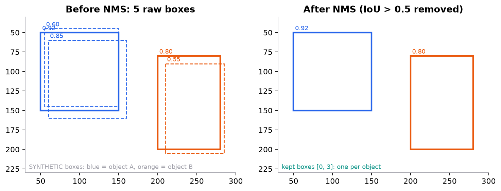

# Object detection and YOLO

> **Mental model.** A detector is a classifier and a ruler run at every position of a feature map at once. Every grid cell guesses "is an object centred here, what is it, and where exactly are its edges?" That produces hundreds of overlapping guesses. Non-maximum suppression then keeps the best guess per object and throws away the echoes.

**You will learn to**
- State what every number in a YOLO-style output tensor means and compute its shape.
- Compute intersection over union (IoU) for two boxes and run non-maximum suppression (NMS) by hand.
- Encode a ground-truth box into the offsets a detector regresses, and decode them back.
- Compute average precision from a ranked list of detections, and explain why mAP@0.5:0.95 is stricter than AP@0.5.
- Diagnose a detector from its metric row and pick the next fix.

**Why it matters.** Classification says "there is a dog". Detection says "a dog at pixels (112, 40, 280, 210) and a cat at (400, 180, 560, 310)". That change, a variable number of labelled boxes instead of one label, is what driving stacks, shelf scanners, document layout parsers, and factory inspection lines depend on. IoU, NMS, and mAP are also a standard interview set for any vision role.

## 1. Intuition

Picture laying a 13 by 13 grid over a photo. Each cell is responsible for objects whose **centre** falls inside it. For each object it owns, a cell answers three questions:

1. **Is there an object centred here?** One number, the *objectness* score.
2. **What is it?** One score per class.
3. **Where are its edges?** Four numbers that place a box.

A convolutional backbone already produces a grid of feature vectors, one per region of the image ([convolutional networks](../13-deep-architectures/01-convolutional-networks.md)). A one-stage detector like YOLO ("You Only Look Once", 2016) adds a $1 \times 1$ convolution that turns each feature vector into those answers. One forward pass, every cell in parallel. That is why YOLO runs in real time.

Two refinements make the box numbers learnable:

- **Anchors.** Objects come in very different shapes: a standing person is tall, a car is wide. Instead of predicting raw widths in pixels, each cell gets a few *anchor boxes* (template shapes, often found by clustering the training boxes) and predicts how much to stretch each one. Several anchors per cell also let one cell hold a person and a bicycle at once.
- **Bounded offsets.** The centre offset passes through a sigmoid, so it stays inside the cell that owns the object.

The network fires many boxes for one object, because neighbouring cells and anchors all see it. The fix is a cleanup step after the network: sort boxes by score, keep the best, delete every other box that overlaps it too much, repeat. That is **non-maximum suppression**. "Overlaps too much" is measured by **IoU**: overlap area divided by combined area. IoU is also how we decide whether a prediction counts as correct when we score the detector.

> [!NOTE]
> **Two-stage versus one-stage.** Faster R-CNN first proposes candidate regions, then classifies each one. It was more accurate but slower. One-stage detectors (YOLO, SSD, RetinaNet) predict directly on the grid. Modern YOLO versions (v8 onward) are *anchor-free*: each cell predicts distances to the four box edges instead of stretching an anchor. Transformer detectors (DETR, RT-DETR) predict a fixed set of boxes and match them to objects one-to-one during training, so they need no NMS at all. The IoU, NMS, and mAP ideas carry over to all of them.

## 2. Visualization



*Five raw predictions on two synthetic objects. NMS keeps box 0 (score 0.92) and box 3 (0.80): every other box overlaps one of these with IoU above 0.5.*

**Try it** (predict first, then check with the script in section 4):
1. Raise the NMS threshold to 0.9. Which boxes survive now? (Hint: box 2 overlaps box 0 with IoU 0.862.)
2. Lower it to 0.1. Could that delete a correct detection of a *different* object? When would two real objects overlap that much?
3. In the AP example, move the false positive with score 0.70 to score 0.30. Predict whether AP goes up or down before you rerun.
4. Swap the anchor list for one with only a single square anchor (100, 100). Predict the new $t_w$ and $t_h$ for the worked box.

## 3. The math

### Symbols

| Symbol | Meaning | Shape |
|---|---|---|
| $S$ | grid size (cells per side) | scalar |
| $B$ | anchors per cell | scalar |
| $C$ | number of classes | scalar |
| $s$ | stride: input pixels per grid cell | scalar |
| $(c_x, c_y)$ | integer column and row of a grid cell | scalars |
| $(t_x, t_y, t_w, t_h)$ | raw box outputs the network regresses | 4 per anchor |
| $(p_w, p_h)$ | anchor width and height in pixels | 2 per anchor |
| $\sigma$ | sigmoid, $1/(1+e^{-x})$ | |
| $A, G$ | a predicted box and a ground-truth box | 4 numbers each |

### Output tensor

For each of $S \times S$ cells and $B$ anchors the head outputs 4 box numbers, 1 objectness, and $C$ class scores:

```math
\text{output shape} = [S,\; S,\; B,\; 5 + C]
```

A 416 by 416 input with stride 32 gives $S = 416/32 = 13$. With $B = 3$ anchors and the 80 COCO classes the head outputs $13 \times 13 \times 3 \times 85 = 43{,}095$ numbers per image.

### Decoding

```math
b_x = (\sigma(t_x) + c_x)\, s, \quad b_y = (\sigma(t_y) + c_y)\, s, \quad b_w = p_w e^{t_w}, \quad b_h = p_h e^{t_h}
```

The sigmoid keeps the centre inside its cell. The exponential keeps width and height positive and makes "twice as wide" and "half as wide" symmetric around $t_w = 0$.

### IoU

```math
\text{IoU}(A, G) = \frac{|A \cap G|}{|A \cup G|} = \frac{|A \cap G|}{|A| + |G| - |A \cap G|}
```

### Loss (YOLOv1–v3 style)

```math
L = \lambda_{\text{coord}} L_{\text{box}}^{\text{obj}} + L_{\text{obj}}^{\text{obj}} + \lambda_{\text{noobj}} L_{\text{obj}}^{\text{noobj}} + L_{\text{cls}}^{\text{obj}}
```

Box and class losses count only for the (cell, anchor) pairs that own an object. Empty pairs contribute only an objectness loss pushing them toward 0. With $13 \times 13 \times 3 = 507$ pairs and a handful of objects, the empty ones vastly outnumber the rest, so YOLOv1 used $\lambda_{\text{noobj}} = 0.5$ and $\lambda_{\text{coord}} = 5$. Modern detectors replace the squared box error with an IoU-based loss (GIoU, DIoU, CIoU) and the plain cross-entropy with focal-style losses, but the three-part structure remains.

### Worked example 1: IoU

Prediction $A = (50, 50, 150, 150)$, ground truth $G = (60, 60, 160, 160)$, as $(x_1, y_1, x_2, y_2)$.

1. Intersection corners: $x_1 = \max(50, 60) = 60$, $y_1 = 60$, $x_2 = \min(150, 160) = 150$, $y_2 = 150$.
2. Intersection area: $(150 - 60)(150 - 60) = 90 \times 90 = 8100$.
3. Areas: $|A| = 100 \times 100 = 10{,}000$, $|G| = 10{,}000$.
4. Union: $10{,}000 + 10{,}000 - 8100 = 11{,}900$.
5. IoU $= 8100 / 11{,}900 = 0.6807$.

A 10-pixel shift on a 100-pixel box already costs a third of the IoU. That is why strict thresholds like 0.75 are hard.

### Worked example 2: encode a box

Ground truth $(120, 80, 240, 220)$, stride $s = 32$, anchors $(30, 60)$, $(75, 170)$, $(200, 380)$.

1. Centre $= ((120+240)/2,\ (80+220)/2) = (180, 150)$. Size $w = 120$, $h = 140$.
2. Grid position: $180/32 = 5.625$, $150/32 = 4.6875$. So cell $(c_x, c_y) = (5, 4)$ with in-cell offsets $0.625$ and $0.6875$.
3. Pick the anchor whose shape overlaps best (boxes aligned at one corner). For anchor $(75, 170)$: intersection $\min(120,75) \times \min(140,170) = 75 \times 140 = 10{,}500$; union $16{,}800 + 12{,}750 - 10{,}500 = 19{,}050$; shape IoU $0.551$. The other two score $0.107$ and $0.221$, so anchor 1 wins.
4. Invert the sigmoid: $t_x = \ln\frac{0.625}{0.375} = \ln 1.667 = 0.5108$, $t_y = \ln\frac{0.6875}{0.3125} = \ln 2.2 = 0.7885$.
5. Invert the exponential: $t_w = \ln(120/75) = \ln 1.6 = 0.4700$, $t_h = \ln(140/170) = \ln 0.8235 = -0.1942$.

Decoding: $\sigma(0.5108) = 0.625$, $(0.625 + 5) \times 32 = 180$; $75 e^{0.47} = 120$. The box comes back exactly.

### Worked example 3: average precision at IoU 0.5

Three ground-truth objects; five detections sorted by score. A detection is a true positive (TP) if its IoU with an unmatched ground-truth box is at least 0.5; a second hit on the same object is a false positive.

| Rank | Score | TP? | Precision = TP so far / rank | Recall = TP so far / 3 |
|---|---|---|---|---|
| 1 | 0.95 | yes | 1/1 = 1.000 | 0.333 |
| 2 | 0.90 | yes | 2/2 = 1.000 | 0.667 |
| 3 | 0.70 | no (duplicate) | 2/3 = 0.667 | 0.667 |
| 4 | 0.60 | no (empty space) | 2/4 = 0.500 | 0.667 |
| 5 | 0.40 | yes | 3/5 = 0.600 | 1.000 |

AP is the area under the precision-recall curve after replacing each precision with the best precision at that recall or higher (the "envelope"): $[1, 1, 0.667, 0.6, 0.6]$. Recall only rises at ranks 1, 2, and 5, each by $1/3$:

```math
\text{AP} = 1 \times \tfrac{1}{3} + 1 \times \tfrac{1}{3} + 0.6 \times \tfrac{1}{3} = 0.8667
```

mAP@0.5 averages this over classes. COCO's mAP@0.5:0.95 also averages over ten IoU thresholds $0.50, 0.55, \dots, 0.95$, so loosely placed boxes that pass at 0.5 but fail at 0.75 drag it down. (COCO interpolates at 101 fixed recall points; the idea is the same.)

## 4. Implementation

The full script is [`code/25-computer-vision/detection_scratch.py`](../../code/25-computer-vision/detection_scratch.py) (NumPy only). It builds IoU, NMS, the box codec, anchor assignment, and AP, then reproduces every worked example above.

### Build it from scratch

**Step 1: pairwise IoU.** Everything in detection reduces to "how much do these boxes overlap?", for many pairs at once. Broadcasting `[:, None]` against `[None, :]` gives the full `[Na, Nb]` matrix with no loops. The `clip(..., 0)` handles boxes that don't touch: their "intersection width" would be negative.

```python
def box_iou(a, b):
    """a: [Na, 4], b: [Nb, 4] boxes as (x1, y1, x2, y2). Returns [Na, Nb] pairwise IoU."""
    x1 = np.maximum(a[:, None, 0], b[None, :, 0])    # intersection corners, broadcast to [Na, Nb]
    y1 = np.maximum(a[:, None, 1], b[None, :, 1])
    x2 = np.minimum(a[:, None, 2], b[None, :, 2])
    y2 = np.minimum(a[:, None, 3], b[None, :, 3])
    inter = np.clip(x2 - x1, 0, None) * np.clip(y2 - y1, 0, None)   # 0 when boxes don't overlap
    area_a = (a[:, 2] - a[:, 0]) * (a[:, 3] - a[:, 1])
    area_b = (b[:, 2] - b[:, 0]) * (b[:, 3] - b[:, 1])
    return inter / (area_a[:, None] + area_b[None, :] - inter)
```

*Predict:* what does `box_iou` return for two boxes that touch only along an edge, like `(0, 0, 10, 10)` and `(10, 0, 20, 10)`?

**Step 2: greedy NMS.** Keep the top-scoring box, drop every remaining box whose IoU with it exceeds the threshold, and repeat on what is left. It never merges or averages boxes, it only deletes.

```python
def nms(boxes, scores, iou_threshold=0.5):
    order = np.argsort(-scores)                        # highest score first
    keep = []
    while len(order):
        i = order[0]
        keep.append(int(i))
        ious = box_iou(boxes[[i]], boxes[order[1:]])[0]
        order = order[1:][ious <= iou_threshold]      # survivors: boxes that overlap i too little
    return keep
```

*Predict:* production detectors run NMS separately per class. What goes wrong in a crowded street if you run one class-agnostic NMS over people and bicycles together?

**Step 3: the box codec.** The network never outputs pixels. It outputs offsets relative to a cell and an anchor, and `decode` is the exact inverse of `encode`. Training targets come from `encode`; predictions are read with `decode`.

```python
def encode(box, cell_x, cell_y, stride, anchor_wh):
    """Pixel box (x1, y1, x2, y2) -> regression targets (tx, ty, tw, th)."""
    cx, cy = (box[0] + box[2]) / 2, (box[1] + box[3]) / 2
    w, h = box[2] - box[0], box[3] - box[1]
    off_x, off_y = cx / stride - cell_x, cy / stride - cell_y      # centre offset inside the cell, in [0, 1)
    return np.array([logit(off_x), logit(off_y), np.log(w / anchor_wh[0]), np.log(h / anchor_wh[1])])

def decode(t, cell_x, cell_y, stride, anchor_wh):
    cx = (sigmoid(t[0]) + cell_x) * stride            # sigmoid keeps the centre inside its cell
    cy = (sigmoid(t[1]) + cell_y) * stride
    w = anchor_wh[0] * np.exp(t[2])                   # exp keeps width positive, scales the anchor
    h = anchor_wh[1] * np.exp(t[3])
    return np.array([cx - w / 2, cy - h / 2, cx + w / 2, cy + h / 2])
```

*Predict:* an object centred exactly on a cell boundary has offset 0. What is `logit(0)`, and why do real implementations clip the offset to something like `[1e-6, 1 - 1e-6]` (or use YOLOv5's wider `2σ(t) - 0.5` range)?

**Step 4: who owns the object?** Each ground-truth box is assigned to the cell containing its centre and the anchor whose shape fits best. Only that (cell, anchor) pair gets box and class targets; all others learn "no object".

```python
def assign(box, anchors, stride):
    """Which grid cell and which anchor are responsible for this ground-truth box?"""
    cx, cy = (box[0] + box[2]) / 2, (box[1] + box[3]) / 2
    w, h = box[2] - box[0], box[3] - box[1]
    shape_iou = [min(w, aw) * min(h, ah) / (w * h + aw * ah - min(w, aw) * min(h, ah)) for aw, ah in anchors]
    return int(cx // stride), int(cy // stride), int(np.argmax(shape_iou)), shape_iou
```

*Predict:* two people stand so close that their centres fall in the same cell and both best match the same anchor. What happens to one of them during training?

**Step 5: average precision.** Sort detections by score, greedily match each to an unmatched ground-truth box at IoU at least 0.5, then integrate precision over recall using the precision envelope.

```python
def average_precision(pred_boxes, pred_scores, gt_boxes, iou_thr=0.5):
    order = np.argsort(-pred_scores)
    matched = set()
    tp = []
    for i in order:                                    # greedy: each GT box can be matched once
        ious = box_iou(pred_boxes[[i]], gt_boxes)[0]
        j = int(np.argmax(ious))
        hit = ious[j] >= iou_thr and j not in matched
        if hit:
            matched.add(j)
        tp.append(hit)
    tp = np.array(tp, dtype=float)
    precision = np.cumsum(tp) / np.arange(1, len(tp) + 1)
    recall = np.cumsum(tp) / len(gt_boxes)
    # area under the precision envelope (all-point interpolation, as in COCO/VOC2010+)
    envelope = np.maximum.accumulate(precision[::-1])[::-1]
    recall_steps = np.diff(np.concatenate([[0.0], recall]))
    return float(np.sum(envelope * recall_steps)), precision, recall, tp
```

*Predict:* the duplicate box at rank 3 is a false positive here. If NMS had removed it, which ranks' precision would change, and would AP rise?

### Use the library

`torchvision` ships IoU and NMS as fused, batched operators, plus pretrained detectors. The Ultralytics package wraps training and inference for its YOLO family (note its AGPL-3.0 license before shipping it in a product).

```python
import torch
from torchvision.ops import box_iou, batched_nms              # pip install torch torchvision
from torchvision.models.detection import fasterrcnn_resnet50_fpn_v2

keep = batched_nms(boxes, scores, class_ids, iou_threshold=0.5)  # per-class NMS in one call
model = fasterrcnn_resnet50_fpn_v2(weights="DEFAULT").eval()
with torch.no_grad():
    out = model([image_tensor])[0]                             # dict: boxes [K, 4], scores [K], labels [K]

# from ultralytics import YOLO
# results = YOLO("yolov8n.pt")("street.jpg")                   # decode + NMS done for you
```

What the library adds: per-class NMS (`batched_nms` offsets boxes per class so classes never suppress each other), GPU kernels, feature pyramids that predict at several strides (small objects on fine grids, large on coarse), and COCO-style evaluation through `pycocotools`.

### Run it

```bash
uv run code/25-computer-vision/detection_scratch.py
```

Key lines of output (all boxes are synthetic):

```text
worked example: IoU = 0.6807  (8100 / 11900)
kept (threshold 0.5): [0, 3]
gt box [120.0, 80.0, 240.0, 220.0] -> centre (180, 150) -> cell (5, 4); shape IoU with anchors [0.107, 0.551, 0.221] -> anchor 1 (75, 170)
targets (tx, ty, tw, th) = [0.5108, 0.7885, 0.47, -0.1942]
decoded back: [120.0, 80.0, 240.0, 220.0]
output tensor for a 416x416 input, stride 32, 3 anchors, 80 classes: [13, 13, 3, 85] = 43,095 numbers
AP@0.5 = 0.8667
```

## 5. Engineering

**Use cases.** Counting and tracking (traffic, retail shelves, wildlife cameras), safety zones on factory floors, document layout (tables, figures, signatures), and as the first stage of pipelines that crop and then classify, read text, or estimate pose.

**Choosing a detector.** Real-time on an edge device: a small one-stage model (YOLO-family "n" or "s" sizes, RT-DETR small variants) exported to ONNX or TensorRT. Highest accuracy offline: larger transformer detectors. Classes not in any dataset: an open-vocabulary detector (Grounding DINO, OWL-ViT style) that takes text prompts, built on the image-text alignment from [CLIP](05-clip-contrastive-pretraining.md).

**Data.** Box labelling is expensive, so label consistency matters more than volume: decide once whether a half-hidden car gets a box, and whether boxes hug visible pixels or the estimated full extent. Augment with flips, scale jitter, and mosaic (four images tiled into one, so the model sees many small objects). Never apply a geometric augmentation to the image without applying it to the boxes.

**Compute and latency.** Quote latency for the whole pipeline: preprocessing, the forward pass, decode, and NMS. NMS on thousands of low-confidence boxes can dominate on CPU, which is one reason NMS-free designs (DETR family, YOLOv10's one-to-one head) exist. A confidence threshold before NMS (0.25 is a common default for display, 0.001 for mAP evaluation) controls how many boxes reach it.

**Reading the metric row.** High precision, low recall: the model is too conservative; lower the confidence threshold or check for small objects lost by a coarse stride. High AP@0.5 but low mAP@0.5:0.95: objects are found but boxes are loose; try an IoU-based box loss or higher-resolution features. Good mAP but bad in production: compare object size, lighting, and camera angle distributions with the training set.

> [!WARNING]
> **Failure modes.** Small objects vanish on a stride-32 grid (a 20-pixel object is under one cell); crowds get suppressed by NMS when real objects overlap above the threshold; a class-agnostic NMS lets a confident "person" box delete a correct "bicycle" box; images resized without keeping the aspect ratio distort every box; coordinates mixed between $(x_1, y_1, x_2, y_2)$, $(c_x, c_y, w, h)$, and normalized $[0, 1]$ formats silently shift predictions.

### Common mistakes

- Reporting only mAP@0.5 and calling localization "good".
- Evaluating with a high confidence threshold. mAP needs the full ranked list, low scores included.
- Tuning the NMS threshold on the test set.
- Comparing mAP numbers computed by different tools or at different input resolutions.
- Forgetting that anchors tuned for one dataset (say, pedestrians) fit another (say, shipping containers) badly.
- Treating a confidence score as a calibrated probability that the box is right.

## 6. Knowledge check

<!-- quiz:object-detection-yolo -->
**[Take the object detection quiz](../../quizzes/object-detection-yolo.md)**: output shapes, IoU arithmetic, NMS behaviour, and reading mAP.
<!-- /quiz -->

**Practice exercise.** A detector predicts box $(0, 0, 40, 40)$ for an object whose ground truth is $(10, 10, 50, 50)$. Compute the IoU. Does it count as a true positive at the 0.5 threshold? At 0.75?

<details>
<summary>Solution</summary>

Intersection: $x$ from 10 to 40, $y$ from 10 to 40, area $30 \times 30 = 900$. Each box has area $40 \times 40 = 1600$. Union $= 1600 + 1600 - 900 = 2300$. IoU $= 900 / 2300 = 0.391$. It fails even the 0.5 threshold, so it is a false positive and the object counts as missed. A 10-pixel shift on a 40-pixel box is far worse than the same shift on a 100-pixel box (0.68 in worked example 1). Small objects need much more precise boxes.

</details>

**Implementation challenge.** Add *Soft-NMS* to the script: instead of deleting an overlapping box, multiply its score by $e^{-\text{IoU}^2/\sigma}$ with $\sigma = 0.5$, and keep every box whose score stays above 0.001. Run it on the five-box example and report the final scores.

<details>
<summary>Solution sketch</summary>

```python
def soft_nms(boxes, scores, sigma=0.5, min_score=1e-3):
    scores = scores.copy()
    idx = list(range(len(boxes)))
    keep = []
    while idx:
        i = max(idx, key=lambda k: scores[k])
        keep.append(i)
        idx.remove(i)
        for j in idx:
            scores[j] *= np.exp(-box_iou(boxes[[i]], boxes[[j]])[0, 0] ** 2 / sigma)
        idx = [j for j in idx if scores[j] > min_score]
    return keep, scores
```

All five boxes survive, in the order 0, 3, 1, 4, 2, with final scores 0.92, 0.80, 0.337, 0.189, and 0.059. Box 2 is decayed twice: when box 0 is kept (IoU 0.862, factor $e^{-0.743/0.5} = 0.226$, so $0.60 \to 0.136$) and again when box 1 is kept (IoU 0.646, factor 0.434, so $0.136 \to 0.059$). A display threshold of 0.25 then shows boxes 0, 3, and 1. Soft-NMS helps in crowds, where a real second object overlapping the first is down-weighted instead of deleted.

</details>

## Summary

- A one-stage detector predicts, for every grid cell and anchor, 4 box offsets, 1 objectness score, and $C$ class scores: an $[S, S, B, 5 + C]$ tensor.
- Box offsets are relative: a sigmoid keeps the centre in its cell, an exponential scales an anchor. Encode builds training targets; decode reads predictions.
- IoU measures box overlap; NMS keeps the best box and deletes overlapping duplicates, per class.
- AP integrates precision over recall at one IoU threshold; mAP@0.5:0.95 averages over classes and strict thresholds, so it rewards tight boxes.
- Modern detectors drop anchors or NMS, but IoU, assignment, and mAP remain the core vocabulary.

**Next:** [Semantic segmentation and U-Net](02-semantic-segmentation-unet.md)

**Related:** [Convolutional networks](../13-deep-architectures/01-convolutional-networks.md) · [Classification metrics](../04-classification/02-classification-metrics.md) · [Vision transformers](03-vision-transformers.md)

<!-- deeper: generated from guide/upstream/map.json by web/scripts/gen-upstream.mjs; edit the map, then run npm run gen:upstream -->
**Go deeper, code-first** ([AI Engineering from Scratch](https://aiengineeringfromscratch.com)): [Instance Segmentation — Mask R-CNN](https://aiengineeringfromscratch.com/lesson?path=phases/04-computer-vision/08-instance-segmentation-mask-rcnn)

*Parts of this lesson are adapted from [AI Engineering from Scratch](https://github.com/rohitg00/ai-engineering-from-scratch) by Rohit Ghumare (MIT license, [notice](../../upstream/LICENSE-ai-engineering-from-scratch.txt)): [Object Detection — YOLO from Scratch](https://aiengineeringfromscratch.com/lesson?path=phases/04-computer-vision/06-object-detection-yolo).*
<!-- /deeper -->

## Interview angle

<details>
<summary><strong>Walk me through what a YOLO-style head outputs and how you turn it into final boxes.</strong></summary>

The backbone produces a feature map, say 13 by 13 for a 416-pixel input at stride 32. A 1 by 1 convolution maps each cell's feature vector to B anchors times (5 + C) numbers: four box offsets, one objectness logit, and C class logits. So the tensor is [13, 13, B, 5 + C]; with 3 anchors and 80 classes that is 43,095 numbers. To decode, take the sigmoid of the centre offsets, add the cell index, and multiply by the stride; multiply each anchor's width and height by the exponential of its offsets. Score each box as objectness times the best class probability, drop boxes below a confidence threshold, then run NMS per class: sort by score, keep the best, remove any same-class box with IoU above about 0.5, repeat. Anchor-free versions predict distances to the four edges instead, but the decode-threshold-NMS flow is the same.

</details>

<details>
<summary><strong>Why does mAP@0.5:0.95 sit far below AP@0.5 for some models, and what would you change?</strong></summary>

AP@0.5 accepts any box overlapping the object by half. mAP@0.5:0.95 averages AP over ten thresholds up to 0.95, so it rewards tight boxes. A big gap, say 0.75 versus 0.32, means the model finds the right objects but places loose boxes. A 10-pixel shift on a 100-pixel box already drops IoU to 0.68, failing every threshold from 0.70 up. Fixes target localization: an IoU-based regression loss (GIoU, DIoU, CIoU) instead of squared error on offsets; higher-resolution features or a feature pyramid so small objects get fine strides; better label quality, since inconsistent box tightness in annotations caps what the model can learn; and test-time checks that resizing preserves aspect ratio. Raising the confidence threshold will not help, since it changes which boxes are kept, not where they sit.

</details>

<details>
<summary><strong>Your detector misses people in dense crowds even though recall on isolated people is high. Diagnose it.</strong></summary>

Start with NMS. In a crowd, two real people can overlap with IoU above the 0.5 threshold, so the weaker detection is deleted as a "duplicate". Check by running evaluation with NMS thresholds of 0.5, 0.6, and 0.7 and watching crowd recall. Remedies include a higher threshold for that class, Soft-NMS (decay scores instead of deleting), or an NMS-free detector. Second, check assignment: if two people's centres land in the same cell and best match the same anchor, only one becomes a training target, so the model learns to predict one. Finer strides and more anchors, or modern dynamic assignment, help. Third, check labels: crowd regions are often marked "ignore" or labelled inconsistently. Finally, check resolution: people far from the camera may be only a few cells tall at stride 32.

</details>

<details>
<summary><strong>Quick calculation: a prediction is (0, 0, 40, 40) and the ground truth is (10, 10, 50, 50). Is it a hit?</strong></summary>

Compute the intersection first: x runs from 10 to 40 and y from 10 to 40, so it is 30 by 30 = 900 square pixels. Each box is 40 by 40 = 1600. The union is 1600 + 1600 − 900 = 2300, so IoU is 900 / 2300 ≈ 0.39. That is below 0.5, so at the usual PASCAL threshold the prediction is a false positive and the object also counts as a miss, hurting both precision and recall. The broader point is scale: the same 10-pixel offset on a 100-pixel box gives IoU around 0.68. Small objects need proportionally tighter localization, which is why COCO reports AP separately for small, medium, and large objects and why small-object performance usually lags.

</details>
